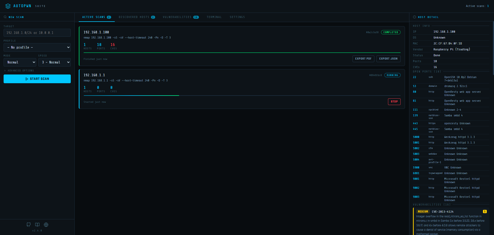
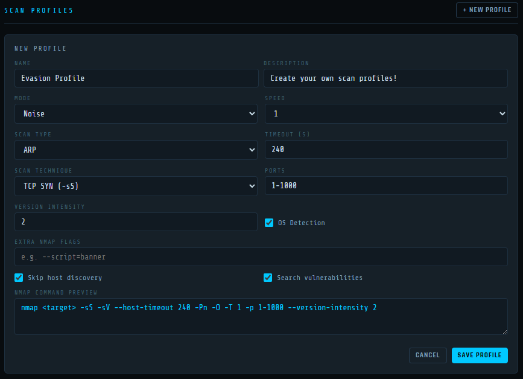
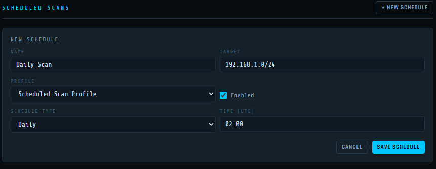
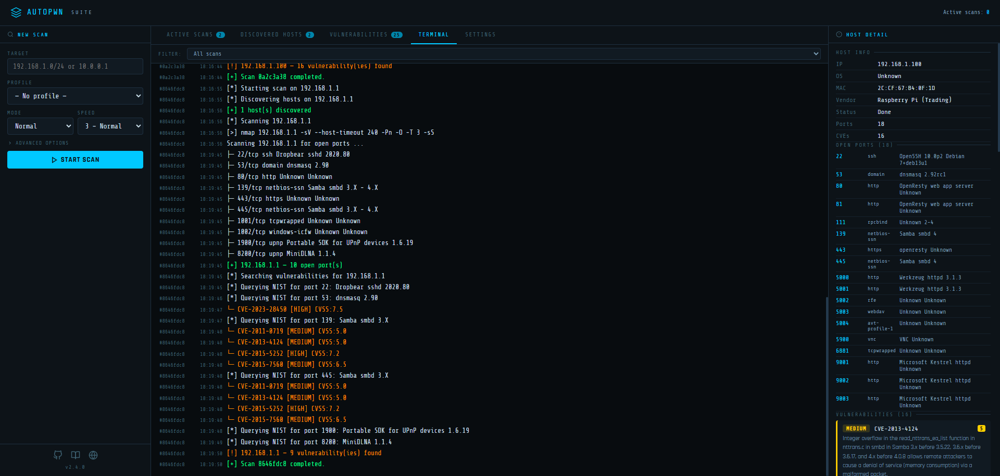

# AutoPWN Suite

AutoPWN Suite is a project for scanning vulnerabilities and exploiting systems automatically.


[](https://github.com/GamehunterKaan/AutoPWN-Suite/actions/workflows/tests.yml)


## Features

### CLI
- Fully [automatic](#usage) scanning and exploitation
- Detect network IP range without any user input
- Vulnerability detection based on service versions
- Web app vulnerability candidates (Unix/Windows LFI, reflected XSS, error-based SQLI)
- Web response header and cookie configuration advisories
- Web app directory discovery with catch-all page filtering
- Get information about vulnerabilities right from your terminal
- Automatically download exploits related to discovered vulnerabilities
- Noise mode for creating traffic on the network
- Evasion mode for stealthy scanning
- Automatically select scan types based on privilege level
- Easy to read output with rich formatting
- Specify arguments using a config file
- Send scan results via webhook or email
- Works on Windows, macOS and Linux
- Use as a [module](#module-usage)
- Use as a [daemon](#install-daemon) to periodically scan the network

### Web UI

AutoPWN Suite includes a built-in web dashboard for managing scans from your browser.



- **Multiple concurrent scans** - Launch and monitor several scans at the same time
- **Live terminal output** - Watch nmap commands and results in real time via SSE
- **Scan progress** - Live Nmap stage percentages, completed CVE lookup counts and target completion counters. The bar follows the current stage; stages without a reported percentage show ongoing activity. Stopped and failed scans retain their last measured progress.
- **Scan profiles** - Save and reuse scan configurations (technique, speed, timeout, ports, evasion, custom flags)
- **Web security dashboard** - Select application checks, inspect captured evidence and remediation, download PoCs, and explicitly replay recorded checks
- **Scheduled scans** - Set up recurring scans on a cron schedule with automatic profile loading
- **Scan techniques** - Choose between TCP SYN, TCP Connect, UDP, Window, ACK, FIN, Xmas, Null, Maimon and SCTP scans
- **Evasion mode** - Fragmented packets, spoofed source port and padded data length
- **Email notifications** - Get notified on scan completion with inline result summaries
- **Webhook notifications** - Post scan results to any webhook endpoint
- **Persistent settings** - All settings, profiles and schedules are saved to disk
- **Configurable via environment variables** - Set host, port and data directory without touching code






## How Does It Work?

AutoPWN Suite uses nmap TCP-SYN scan to enumerate the host and detect the version of software running on it. After gathering enough information about the host, AutoPWN Suite automatically generates a list of keywords to search the [NIST vulnerability database.](https://www.nist.gov/)


## Web application checks

The CLI's existing web vulnerability prompt runs directory discovery and passive header/cookie
checks even on sites with no query inputs. When port results are available it checks each detected
TCP HTTP(S) service, including nonstandard ports; otherwise it tries the host's default web ports.
The crawler follows same-origin links and discovers
GET forms, preserving blank inputs, repeated parameter names and other query values. It skips
POST forms, password forms and uploads. The crawl is limited to 25 pages, 50 discovered URLs
and two levels of links; reaching a budget is reported as limited coverage.

SQLi and LFI checks compare against the original response and repeat promising probes before
reporting new database errors or Unix/Windows file signatures. Reflected XSS checks require an
unescaped payload in a script element or HTML event handler in an HTML response; JSON, plain
text, comments and inactive HTML contexts are excluded. Browser execution and CSP bypass are
not verified, so injection findings remain **candidates** requiring review. Directory hits are
**observations**, with random missing-path controls suppressing soft 404 pages and blanket
login redirects. A protected path is not itself a vulnerability.

Configuration checks report **advisories** for missing/invalid `nosniff`, HTML CSP and framing
protection, HTTPS hostname HSTS, and cookie Secure/HttpOnly/SameSite flags. Cookie values are
excluded from these advisories. Recommendations follow the
[OWASP HTTP Headers Cheat Sheet](https://cheatsheetseries.owasp.org/cheatsheets/HTTP_Headers_Cheat_Sheet.html).
They describe the response observed, not a complete configuration audit.

Additional application checks include:

- **Exposed files and directory indexes:** signature checks for environment files, Git metadata,
  PHP source backups, database dumps, server configuration and backup archives. Directory listings
  require an index heading and multiple child-file links. Sensitive contents are omitted from
  findings; archives are not extracted. Known diagnostic pages and HTTP error stack traces are
  reported without printing their settings or trace details.
- **CORS:** two arbitrary origins and repeated `null` origins test credential permission. Public
  wildcard access alone is not reported as a vulnerability. Wildcard-plus-credentials produces a
  configuration advisory because browsers reject credentialed reads. Actual authenticated data
  exposure is not verified.
- **Open redirects:** redirect-like query parameters are tested with distinct controlled hosts.
  A finding requires repeatable external `Location` destinations; those destinations are never
  visited.
- **Boolean SQLi:** two distinct true/false comparisons must agree against a stable original
  response. Different content types, HTTP errors, SQL errors, unstable pages and truncated bodies
  are excluded. These remain candidates; no timing probes or database extraction are performed.
- **HTTP methods:** OPTIONS advertises capabilities; TRACE requires a repeatable request-line and
  marker-header echo. These are observations. PUT, DELETE, PATCH and CONNECT are not sent, and
  method probes carry no cookies or authorization headers. Automatic `.netrc` authentication is
  suppressed for the additional diagnostic probes.
- **Host headers:** two controlled values for each of Host and X-Forwarded-Host must influence
  redirect hosts or generated absolute URLs. Plain text reflection is ignored. These remain
  candidates, and password reset poisoning or cache poisoning impact is not verified. Requests
  use unique query markers and request cache-control directives.
- **TLS:** certificate expiry, future validity, SAN hostname/IP matching and local trust validation
  are checked independently. Exact-version handshakes test TLS 1.0 and 1.1 support. A finding requires
  successful negotiation; unsupported client capabilities and failed connections are reported as
  incomplete checks. Private CA trust failures are advisories. This is not a complete cipher,
  revocation or certificate-chain audit. Certificate parsing uses `cryptography`.

All HTTP checks share a default budget of 600 requests per web endpoint, including discovery,
crawling and injection probes. Injection and additional checks sample at most 10 discovered URLs
per check family, with at most five parameters per URL. HTTP method checks run on the starting
endpoint. TLS handshakes run separately. Reaching these limits is logged as
limited coverage. Response bodies are read as prefixes capped at 1 MiB and connections are closed;
file contents are not written to disk. Testing guidance follows the
[OWASP Web Security Testing Guide](https://wstg.owasp.org/v4.2/4-Web_Application_Security_Testing/).

Requests have a 10-second timeout and at most three followed redirects. Redirects are checked
before following them; injection probes cannot leave the target origin. Initial endpoint
discovery also permits the same hostname's HTTP port 80 to upgrade to HTTPS port 443.
Self-signed HTTPS targets remain supported for application probes; TLS findings report certificate
and trust problems separately.
Offline mode continues to disable web probes.

Module callers can supply a host, `host:port`, IPv6 address or explicit application URL:

```python
from modules.web.webvuln import webvuln

findings = webvuln("https://example.com:8443/app/", log, console)
```

Each returned finding contains `type`, `url`, `parameter`, `severity`, `confidence`, `evidence`,
an ID, timestamp, detection/impact/remediation context, captured exchanges and a reproduction plan.
Sensitive query values and URL credentials are redacted. Captured exchanges include request roles,
diagnostic headers, status, response-prefix hash/size, latency and truncation state; response bodies
and cookie values are omitted. The CLI prints these results through its existing console/export flow.

### Dashboard controls and verification

Enable **Web checks** in the scan form. Use **Network + selected web checks** to check detected HTTP(S)
services after Nmap, or **Website only** to enter an application URL without requiring Nmap or CVE lookup.
Expand **Select checks** to choose among all 13 check groups. The **Light** preset selects headers/cookies
and TLS; **All** selects every group. Expand **Limits & crawl** to control the HTTP request budget,
timeout, crawl pages/URLs/depth, endpoints per injection/check family, parameters and response size cap.
Save the same controls in a profile and use that profile for scheduled scans.

The **Web Security** tab prioritizes severity and supports search and confidence/severity/scan filters.
Coverage cards show enabled checks, request counts and incomplete-check reasons. Select a finding for:

- **Overview:** observed evidence, detection method, potential impact, remediation, limitations, steps and CWE/OWASP references.
- **Evidence:** baseline/probe/repeat requests, response metadata, available certificate metadata and the complete finding with verification history.
- **PoC & Verify:** preview, copy or download a standalone Python reproducer, POSIX curl commands or a JSON request plan. XSS and credentialed CORS findings also provide a browser PoC.

Downloading or viewing a PoC does not contact the target. **Verify evidence** explicitly replays only
the stored same-origin plan, without authentication cookies, redirects or arbitrary supplied code.
Python verification compares baseline/probe evidence and returns reproduced, not reproduced or
inconclusive, with redacted response metadata. Run a downloaded Python PoC after installing
`requests` and `cryptography`; restore any `REDACTED` query inputs locally first. The dashboard refuses
server replay when local input is required. Browser PoCs require an explicit test click; use a
controlled separate origin and an appropriate browser session to assess CORS or XSS behavior.
Evidence reproduction does not establish database access, browser execution, authenticated data
exposure or other full exploit impact.

The dashboard keeps scan findings in memory for the current process. **Export report** saves filtered
findings with their full evidence and verification history as JSON. Scan JSON exports include web
findings/coverage, and scan PDF exports include their evidence/remediation summaries. Export results
before restarting the dashboard. Offline mode disables web scans and verification while allowing
existing findings and PoCs to be viewed or exported.


## Offline vulnerability database

AutoPWN can keep a portable local mirror of the [NIST NVD JSON 2.0 feeds](https://nvd.nist.gov/vuln/data-feeds).
These are CVE records (descriptions, CVSS scores, affected-product configurations and references),
not exploit programs. The small NIST `.meta` files describe feed freshness, size and checksums;
downloading only those files is insufficient for vulnerability detection.

On a connected machine, explicitly download the database:

```bash
python autopwn.py --update-vuln-db
python autopwn.py --vuln-db-status
```

The first download covers all yearly feeds from 2002 through the current year, including
older CVEs contained in the 2002 feed. Allow several minutes and several GB of free disk space
for the database, feed processing and a temporary update copy. No NIST API key is required for
feed downloads. Repeat `--update-vuln-db` whenever you want fresh data. Each update checks every
year's metadata and downloads only changed yearly feeds, so updates also cover long periods
without internet. Checksums and record counts are verified before publishing the new database;
a failed or interrupted update preserves the previous database. Concurrent updates are rejected.
An update may need to be retried after active scans finish if the operating system locks the database file.

Run an airgapped scan with an explicit target:

```bash
python autopwn.py --offline -t 192.168.1.0/24 -y
python autopwn.py --web --offline
```

Offline mode uses local CVE lookups, skips internet connectivity checks, exploit downloads,
web application probes, automatic Nmap installation and email/webhook delivery, and disables
Nmap reverse DNS. Nmap still communicates with the requested scan targets. Use IP addresses
and locally installed Nmap scripts; user-supplied hostnames or scripts may have their own network
requirements. Install Python dependencies and Nmap before disconnecting, or transfer installation
packages from a connected machine. The dashboard uses local assets and system fonts.

The default `--vuln-source auto` tries online NVD lookups and falls back to a ready local database
if NVD is unavailable, staying local for the rest of that scan. `--vuln-source online` requires
online lookups. Use `--offline` (or `--vuln-source offline`) to avoid trying NVD at all.
Missing or invalid local data fails explicitly rather than reporting a clean vulnerability scan.
Stored data remains usable without an expiry; its update time is shown in scan logs and dashboard
results. Offline matching uses description keyword prefixes, with all query terms required,
and keeps versions such as `10.1.18` distinct from a query for `1.1`. As with online keyword scans,
findings are possible vulnerabilities, not proof of exploitability or exact version applicability.

In the dashboard, **Settings → Offline vulnerability database** provides manual Download/Update,
progress, CVE count, update time and an **Export for airgapped system** link. Select the vulnerability
data source in **New Scan** or save it in a scan profile for scheduled scans. Starting the server
with `--offline` forces every scan to use local data and blocks downloads and test notifications.
The **Offline mode — whole dashboard** toggle in Settings saves this preference across restarts
and overrides the source for all new and scheduled scans. It also blocks downloads and notifications.
Turn it off when you want to download updates. Finish or stop active online scans and let any database
update or pending notification finish before turning it on. A server started with `--offline` keeps offline mode enforced.

The default file is `modules/vulnerabilities.sqlite3`, or `AUTOPWN_DATA_DIR/vulnerabilities.sqlite3`
when that environment variable is set. Copy this single file to the airgapped machine's data
directory, or select its location explicitly:

```bash
python autopwn.py --offline --vuln-db /media/transfer/vulnerabilities.sqlite3 -t 192.168.1.10
python autopwn.py --web --offline --vuln-db /media/transfer/vulnerabilities.sqlite3
```

The database contains public vulnerability data, without scan targets, credentials or exploit files.
It is portable between platforms. Configuration files also support `offline`, `vulnerability_source`
and `vuln_db` in `[AUTOPWN]`. Python callers can use
`AutoScanner().scan("192.168.1.10", offline=True, vuln_db="/path/vulnerabilities.sqlite3")`.

## Demo

AutoPWN Suite has a very user friendly easy to read output.

[](https://asciinema.org/a/509345)


## Installation

### Windows
```bash
git clone https://github.com/GamehunterKaan/AutoPWN-Suite.git
cd AutoPWN-Suite
pip install -r requirements.txt
```

### Linux
For a system-wide installation on Linux (which requires root privileges), use the provided installation script. (Recommended)
```bash
# Install as root
sudo bash install.sh
# Uninstall
sudo bash uninstall.sh
```

You can clone the repo and create a virtual environment. This installation method can be used for non-root installation in Linux.
```bash
git clone https://github.com/GamehunterKaan/AutoPWN-Suite.git
cd AutoPWN-Suite
python3 -m venv .venv
source .venv/bin/activate
pip install -r requirements.txt
```

### Docker

The fastest way to get the web UI running. Download the [docker-compose.yml](https://raw.githubusercontent.com/GamehunterKaan/AutoPWN-Suite/main/docker-compose.yml) file and run:

```bash
docker compose up -d
```

The web UI will be available at `http://localhost:8080`.

#### Configuration

Edit `docker-compose.yml` to change host, port or data directory:

```yaml
environment:
  - AUTOPWN_DATA_DIR=/data        # Where settings/profiles/schedules are stored
  - AUTOPWN_WEB_HOST=0.0.0.0     # Listen address
  - AUTOPWN_WEB_PORT=8080        # Listen port
```

> **Note:** Host networking (`network_mode: host`) is required for nmap to discover and scan devices on your local network.

You can also run the CLI via Docker:
```bash
docker run -it --net=host gamehunterkaan/autopwn-suite -t 192.168.1.0/24 -y
```

### Cloud
You can use Google Cloud Shell.

[](https://shell.cloud.google.com/cloudshell/editor?cloudshell_git_repo=https://github.com/GamehunterKaan/AutoPWN-Suite.git)


## Usage

Running with root privileges (sudo) is always recommended.

### CLI

#### Automatic Mode

```console
autopwn-suite -y
```

#### Scan a Specific Target

```console
autopwn-suite -t <target ip address>
```

#### Change Scanning Speed

```console
autopwn-suite -s <1, 2, 3, 4, 5>
```

#### Change Scanning Mode

```console
autopwn-suite -m <evade, noise, normal>
```

For more details about usage and flags use `-h` flag.

#### Install Daemon
```console
autopwn-suite --daemon-install
```

### Web UI

Launch the web dashboard:

```console
autopwn-suite --web
```

With custom host and port:

```console
autopwn-suite --web --web-host 0.0.0.0 --web-port 3000
```



### REST API

The web UI exposes a full REST API:

| Method | Endpoint | Description |
|--------|----------|-------------|
| `GET` | `/api/scans` | List all scan jobs |
| `POST` | `/api/scan/start` | Start a new scan |
| `POST` | `/api/scan/stop` | Stop a running scan |
| `GET` | `/api/hosts` | All discovered hosts (merged) |
| `GET` | `/api/log` | Log history |
| `GET` | `/api/events` | SSE event stream |
| `GET` | `/api/web/catalog` | Web check names, default controls, bounds and offline state |
| `GET` | `/api/web/findings` | Web finding summaries across current scans |
| `GET` | `/api/web/findings/<scan_id>/<finding_id>` | Complete finding, evidence and verification history |
| `GET` | `/api/web/findings/<scan_id>/<finding_id>/poc?format=python` | Download a PoC; formats: python, curl, html, json |
| `POST` | `/api/web/findings/<scan_id>/<finding_id>/verify` | Explicitly replay the stored plan; send an empty JSON object |
| `GET` | `/api/settings` | Get all settings |
| `PUT` | `/api/settings` | Update settings |
| `GET` | `/api/profiles` | List scan profiles |
| `POST` | `/api/profiles` | Create a profile |
| `PUT` | `/api/profiles/<id>` | Update a profile |
| `DELETE` | `/api/profiles/<id>` | Delete a profile |
| `GET` | `/api/schedules` | List scheduled scans |
| `POST` | `/api/schedules` | Create a schedule |
| `PUT` | `/api/schedules/<id>` | Update a schedule |
| `DELETE` | `/api/schedules/<id>` | Delete a schedule |


## Module Usage

```python
from autopwn_suite.api import AutoScanner

scanner = AutoScanner()
json_results = scanner.scan("192.168.0.1")
scanner.save_to_file("autopwn.json")
```


## Development and Testing

You can use poetry to install dependencies and run tests.

#### Installing Dependencies
```console
poetry install
```

#### Running Tests
```console
# Run all tests with coverage
poetry run test

# Run tests without coverage
poetry run test --no-cov

# Run only unit tests
poetry run test -m unit

# Run only integration tests
poetry run test -m integration

# Run tests excluding slow tests
poetry run test -m "not slow"
```

#### Running with Docker (Development)
```bash
docker compose up --build
```


## Contributing to AutoPWN Suite

I would be glad if you are willing to contribute this project. I am looking forward to merge your pull request unless its something that is not needed or just a personal preference. Also minor changes and bug fixes will not be merged. Please create an issue for those and I will do it myself. [Click here for more info!](https://github.com/GamehunterKaan/AutoPWN-Suite/blob/main/.github/CONTRIBUTING.md)


## Legal

You may not rent or lease, distribute, modify, sell or transfer the software to a third party. AutoPWN Suite is free for distribution, and modification with the condition that credit is provided to the creator and not used for commercial use. You may not use software for illegal or nefarious purposes. No liability for consequential damages to the maximum extent permitted by all applicable laws.


## Support or Contact

Having trouble using this tool? You can [create an issue](https://github.com/GamehunterKaan/AutoPWN-Suite/issues/new/choose) or [create a discussion!](https://github.com/GamehunterKaan/AutoPWN-Suite/discussions)
