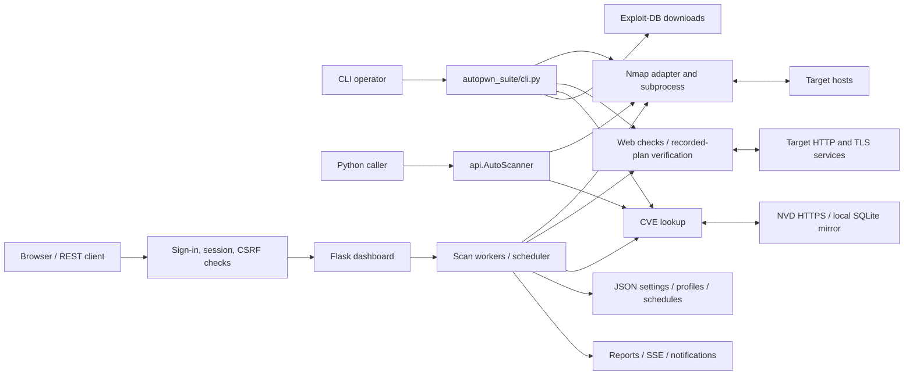

# Architecture and actors

This describes the v2.7 runtime; items marked *Since v2.6.1* are absent from v2.6.0
and earlier. Source references identify the
implementation; the older project website may describe a removed Python Nmap
wrapper. This document and current source take precedence for implementation
details.

## Actors

| Actor | Actions and authority |
| --- | --- |
| Authorized operator | Chooses targets, scan modes/Nmap options (free-text Nmap options only on the command line and in the Python API; the dashboard offers structured controls), database source, reporting destinations and files; runs CLI or dashboard; reviews evidence and explicitly requests PoC replay. |
| Python application caller | Calls `api.AutoScanner`, receives dictionaries, and chooses whether/where to export JSON. The caller has the process's authority. |
| Dashboard browser/API client | Lists and controls all scans, profiles, schedules, settings and exports for that process. There are no separate users or per-object access roles. Since v2.6.1: a client must first sign in as the single shared administrator account (`autopwn_suite/web_auth.py`); v2.6.0 has no login. |
| Scheduler and scan workers | Run enabled schedules with saved profiles, launch Nmap/web probes, track progress, honor cancellation and resume unfinished work. |
| Target hosts and web servers | Supply untrusted service metadata, HTML, redirects, cookies, certificates, HTTP responses, and timing behavior. |
| Nmap executable/NSE | Performs network discovery/probes and supplies XML. Runs with the operator/process privileges; trusted executable and script selection is an operator responsibility. |
| NVD and Exploit-DB | Supply external CVE data and exploit reference/download material. A configured local SQLite mirror supplies offline CVE lookups. |
| SMTP/webhook receivers | Receive explicitly configured scan notifications; outputs may contain sensitive network observations. |
| Maintainer and release automation | Review code/dependencies, administer repository secrets, publish versioned releases and container images, and handle private security reports. |

## Components and flow

1. `autopwn_suite/utils.py` parses CLI/config options; `autopwn_suite/cli.py` orchestrates
   discovery, scanning, CVE lookup, optional exploit downloads and exports.
2. `autopwn_suite/scanner.py` builds discovery/port scans and normalizes observations.
   `autopwn_suite/nmap_backend.py` parses Nmap XML; `autopwn_suite/nmap_progress.py` starts
   the native executable using an argument list, streams progress and handles
   cancellation/timeouts and process cleanup. It does not invoke a shell. The standalone
   Linux binary starts Nmap, `ip`, `systemctl` and the package manager that installs Nmap with
   the library path it was launched with, not the one that points into its unpacked bundle
   (`autopwn_suite/subprocess_env.py`).
3. `autopwn_suite/nist_search.py` and `autopwn_suite/searchvuln.py` map service/version
   observations to candidate CVEs. `autopwn_suite/vulnerability_db.py` reads a local
   mirror or explicitly updates it using validated official annual feeds.
4. `autopwn_suite/web/` discovers same-origin URLs and GET forms, applies bounded
   checks, compares evidence, redacts sensitive fields and produces findings.
   Detection is not proof of full exploitation. `poc.py` generates text/downloads;
   `poc_runtime.py` validates and replays stored plans after an explicit request.
5. `autopwn_suite/web_ui.py` owns process-wide jobs, locks, progress, notifications,
   persistence, REST routes and SSE (log entries carry an increasing id, and the stream resumes after the id in
   `Last-Event-ID` or `after`). `autopwn_suite/web_ui_static/` renders the browser
   UI. Since v2.6.1: `autopwn_suite/web_auth.py` installs the sign-in, session, CSRF,
   `Origin` and HTTPS checks ahead of every route (`install_auth`, called from
   `_build_app`), and `autopwn_suite/credential_files.py` reads `*_FILE` secrets.
   The sign-in page is `login.html`/`login.js`/`login.css`; `auth.js` attaches the
   CSRF token to dashboard requests. A polling scheduler launches saved profiles and records schedule runs.
   Resume retains process-memory checkpoints (a completed job releases them, since it cannot resume); restarting loses jobs/checkpoints.
6. `autopwn_suite/api.py` exposes synchronous Python scanning without starting the web server.
   `autopwn_suite/daemon/daemon_installer.py` generates configuration and a systemd
   service that runs the installed program and removes the service and its configuration again
   (`--daemon-uninstall`). `install.sh`/`uninstall.sh` manage a
   system-wide virtual environment (they honor `PREFIX`, `BINDIR`, `APPDIR` and
   `DESTDIR`). Releases are also distributed as a PyPI package and as standalone
   PyInstaller binaries defined in `packaging/` and built, twice and byte-identical, by
   `scripts/build_binary.py` in `.github/workflows/build-binary.yml` with the interpreter pinned in
   `packaging/build-python.json`.

## Resources, deployment and boundaries

| Resource / boundary | Effective behavior and responsibility |
| --- | --- |
| Dashboard socket | v2.6.0 defaults to `0.0.0.0:8080` with no built-in authentication and enables CORS. Since v2.6.1: defaults to `127.0.0.1:8080` (the Dockerfile sets `0.0.0.0` inside the container, and a bridge-published port reaches it from the bridge gateway, which is not loopback, so plain-HTTP sign-in there needs host networking with `AUTOPWN_WEB_HOST=127.0.0.1`, as the Compose file uses), requires sign-in on every route, no longer enables CORS and rejects mismatched `Origin` headers, and requires HTTPS from non-loopback clients (or `AUTOPWN_WEB_SECURE_COOKIE=1` behind a TLS-terminating proxy). CLI options override environment defaults, then present INI WEBUI values override the parsed CLI values. Access is still administrative authority over one shared account with no MFA: keep the loopback bind or provide HTTPS and a firewall/VPN. |
| Dashboard files | `AUTOPWN_DATA_DIR` or the per-user data directory (`~/.local/share/autopwn-suite`, `%LOCALAPPDATA%\autopwn-suite` or `~/Library/Application Support/autopwn-suite`) contains `web_ui_settings.json`, `web_ui_profiles.json`, and `web_ui_schedules.json`. Settings can include credentials; files are JSON, not an encrypted secret store, and are written with mode `0600` on POSIX; at start the dashboard restricts existing files that an earlier release left readable by others to `0600`. A profiles or schedules file that cannot be loaded, holds invalid entries, or holds a profile or schedule that this release refuses (Nmap options saved by an earlier release, or a technique or ports outside the structured lists) is kept beside the original as `<name>.corrupt-<UTC timestamp>` (one copy of an identical file) instead of being overwritten by the next save. Restrict filesystem/backups accordingly. Since v2.6.1: `web_ui_auth.json` holds the administrator username (plaintext) and scrypt hash, and `AUTOPWN_NIST_API_KEY_FILE`, `AUTOPWN_SMTP_PASSWORD_FILE` and `AUTOPWN_WEBHOOK_URL_FILE` supply secrets from separate files that the dashboard never copies into the settings file. |
| Local CVE database | Explicit `--vuln-db` overrides the default `vulnerabilities.sqlite3` under `AUTOPWN_DATA_DIR` or the per-user data directory (`~/.local/share/autopwn-suite`, `%LOCALAPPDATA%\autopwn-suite` or `~/Library/Application Support/autopwn-suite`). Readers use a read-only snapshot; updates stage, verify and replace the complete database under an update lock. On POSIX a reader keeps its snapshot across the replace; on Windows an open reader blocks the replace (sharing violation or access denied), so the updater probes for it before downloading; a scan that opens the database during the download still blocks the final replace, which is retried for a few seconds before the finished download is discarded with a "close running scans" message (which also names a read-only file, since Windows reports that the same way) while the old database is kept. Any other permission error is reported as it is. Each feed request is tried up to three times on network errors, 429 and 5xx answers; a 404 for the newest year's feed is reported as "not published yet" and skipped only when that year was never indexed, and every other failure discards the staged copy. The skip is named in the update's last message but is not stored in the database, which lacks that year's CVEs until a later update indexes them. |
| Container | `Dockerfile` runs the application as the container's default user; plain Docker defaults JSON/database storage to `~/.local/share/autopwn-suite` inside the container. Since v2.6.1: the image pins its base image by digest, installs Debian packages from a dated snapshot and Python packages from the hash-pinned `requirements-locked.txt` (generated from `poetry.lock`), and honors `SOURCE_DATE_EPOCH`; see [Building](BUILDING.md). Supplied Compose uses host networking, sets `AUTOPWN_WEB_HOST=127.0.0.1` and a named volume at `/data`; its `AUTOPWN_DATA_DIR=/data` puts the JSON files (including the account file) and the default CVE database in that volume. The volume is not encrypted or isolated by application user roles. CWD-based outputs/downloads are separate. |
| Nmap and systemd | Process privileges carry into network operations and NSE. Some scans and service installation need root; custom flags are trusted operator capabilities of the command line and the Python API, not a sandbox for untrusted clients, so the dashboard (an administrative API) accepts no free-text Nmap options and builds its arguments from structured controls. |
| Target responses | Treat all scan results, links, descriptions and redirects as untrusted. Web discovery is same-origin and budgeted; HTML display must escape results, and the finding text, log lines and coverage notes of a web scan drop control characters (ESC, CR, C1 codes) so a target cannot drive the operator's terminal. Log lines, coverage notes, the announcement line and the target a dashboard job record shows redact every query value, userinfo and fragment of a URL (`redact_text`); findings redact credential-named query values only (`redact_url`), because a PoC replays the rest. Since v2.6.1: web scan requests and replay verify target certificates by default (`--insecure-tls` or the dashboard's "Accept untrusted certificates" option opts out, and the choice is recorded with findings). Target TLS diagnostics intentionally inspect certificate failures/legacy protocols without trusting them or sending HTTP/credentials, unlike trusted update/distribution channels. |
| Offline mode | Disables online lookups, web probes/replay, notifications, exploit downloads and automatic Nmap installation. Nmap still contacts selected targets. User hostnames and, on the command line and in the Python API, NSE scripts can have their own network behavior. |
| Release boundary | Pull-request tests use hosted runners and read-only credentials. Only trusted release/dispatch workflows can publish/sign; source tags must resolve to reviewed history. See [Releasing](RELEASING.md) and [Governance](../GOVERNANCE.md). |

The software is an operator-controlled security tool, not a multi-tenant scanning
service. Target control must not imply control of operator files, credentials or
browser execution. See [Security assessment](SECURITY_ASSESSMENT.md) for reviewed
threats and limitations, [Threat model](THREAT_MODEL.md) for attack surfaces and
effective resources, and [Interfaces](INTERFACES.md) for inputs and outputs.
