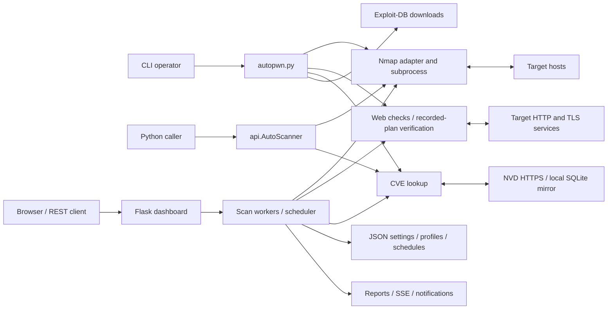

# Architecture and actors

This describes the v2.6 runtime. Source references identify the implementation;
the older project website may describe a removed Python Nmap wrapper. This
document and current source take precedence for implementation details.

## Actors

| Actor | Actions and authority |
| --- | --- |
| Authorized operator | Chooses targets, scan modes/Nmap options, database source, reporting destinations and files; runs CLI or dashboard; reviews evidence and explicitly requests PoC replay. |
| Python application caller | Calls `api.AutoScanner`, receives dictionaries, and chooses whether/where to export JSON. The caller has the process's authority. |
| Dashboard browser/API client | Lists and controls all scans, profiles, schedules, settings and exports for that process. There are no separate users or per-object access roles. |
| Scheduler and scan workers | Run enabled schedules with saved profiles, launch Nmap/web probes, track progress, honor cancellation and resume unfinished work. |
| Target hosts and web servers | Supply untrusted service metadata, HTML, redirects, cookies, certificates, HTTP responses, and timing behavior. |
| Nmap executable/NSE | Performs network discovery/probes and supplies XML. Runs with the operator/process privileges; trusted executable and script selection is an operator responsibility. |
| NVD and Exploit-DB | Supply external CVE data and exploit reference/download material. A configured local SQLite mirror supplies offline CVE lookups. |
| SMTP/webhook receivers | Receive explicitly configured scan notifications; outputs may contain sensitive network observations. |
| Maintainer and release automation | Review code/dependencies, administer repository secrets, publish versioned releases and container images, and handle private security reports. |

## Components and flow

1. `modules/utils.py` parses CLI/config options; `autopwn.py` orchestrates
   discovery, scanning, CVE lookup, optional exploit downloads and exports.
2. `modules/scanner.py` builds discovery/port scans and normalizes observations.
   `modules/nmap_backend.py` parses Nmap XML; `modules/nmap_progress.py` starts
   the native executable using an argument list, streams progress and handles
   cancellation/timeouts and process cleanup. It does not invoke a shell.
3. `modules/nist_search.py` and `modules/searchvuln.py` map service/version
   observations to candidate CVEs. `modules/vulnerability_db.py` reads a local
   mirror or explicitly updates it using validated official annual feeds.
4. `modules/web/` discovers same-origin URLs and GET forms, applies bounded
   checks, compares evidence, redacts sensitive fields and produces findings.
   Detection is not proof of full exploitation. `poc.py` generates text/downloads;
   `poc_runtime.py` validates and replays stored plans after an explicit request.
5. `modules/web_ui.py` owns process-wide jobs, locks, progress, notifications,
   persistence, REST routes and SSE. `modules/web_ui_static/` renders the browser
   UI. A polling scheduler launches saved profiles and records schedule runs.
   Resume retains process-memory checkpoints; restarting loses jobs/checkpoints.
6. `api.py` exposes synchronous Python scanning without starting the web server.
   `modules/daemon/daemon_installer.py` generates configuration and a systemd
   service. `install.sh`/`uninstall.sh` manage a system-wide Python installation.

## Resources, deployment and boundaries

| Resource / boundary | Effective behavior and responsibility |
| --- | --- |
| Dashboard socket | Defaults to `0.0.0.0:8080`; CLI options override environment defaults. Flask has no built-in authentication and enables CORS. Treat access as administrative authority; bind to loopback or protect the entire service with authenticated access and a firewall. |
| Dashboard files | `AUTOPWN_DATA_DIR` or the `modules/` directory contains `web_ui_settings.json`, `web_ui_profiles.json`, and `web_ui_schedules.json`. Settings include credentials; files are JSON, not an encrypted secret store. Restrict filesystem/backups accordingly. |
| Local CVE database | Explicit `--vuln-db` overrides the default `vulnerabilities.sqlite3` under `AUTOPWN_DATA_DIR` or `modules/`. Readers use a read-only snapshot; updates stage, verify and replace the complete database under an update lock. |
| Container | `Dockerfile` runs the application as the container's default user; Compose uses host networking and a named volume at `/data`. `AUTOPWN_DATA_DIR=/data` puts all three JSON files and the default CVE database in that volume. The volume is not encrypted or isolated by application user roles. |
| Nmap and systemd | Process privileges carry into network operations and NSE. Some scans and service installation need root; custom flags are trusted operator capabilities, not a sandbox for untrusted clients. |
| Target responses | Treat all scan results, links, descriptions and redirects as untrusted. Web discovery is same-origin and budgeted; HTML display must escape results. Target TLS diagnostics intentionally inspect certificate failures/legacy protocols, unlike trusted update/distribution channels. |
| Offline mode | Disables online lookups, web probes/replay, notifications, exploit downloads and automatic Nmap installation. Nmap still contacts selected targets. User hostnames/NSE scripts can have their own network behavior. |
| Release boundary | Pull-request tests use hosted runners and read-only credentials. Only trusted release/dispatch workflows can publish/sign; source tags must resolve to reviewed history. See [Releasing](RELEASING.md) and [Governance](../GOVERNANCE.md). |

The software is an operator-controlled security tool, not a multi-tenant scanning
service. Target control must not imply control of operator files, credentials or
browser execution. See [Security assessment](SECURITY_ASSESSMENT.md) for reviewed
threats and limitations and [Interfaces](INTERFACES.md) for inputs and outputs.
