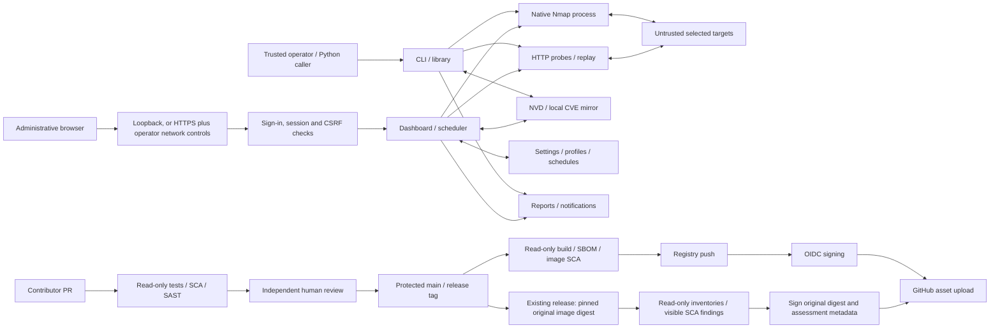

# AutoPWN Suite threat model and attack surface

Assessed 2026-10-15. Runtime scope is v2.6.0; the model also covers the
Baseline 2/3 CI and release automation proposed on `security/openssf-baseline-2`,
which shipped in v2.6.1.
An independent, fresh-context source review mapped runtime resources; the parent
verified material consumers and reconciled the subsequently separated release
jobs. This is static architecture analysis, not a penetration test or a new
repository security audit. The five validated runtime findings remain attributed
to [the assessment](SECURITY_ASSESSMENT.md), not newly discovered here.
The 2026-10-16 update adds a metadata-only authenticity-backfill path for already
published releases, with existing-image findings preserved in signed reports.
Review-event notifications now refresh the original PR approval run through a
trusted default-branch handler, avoiding duplicate required approval checks.
New publication staging bundles supporting reports and notes into one ZIP;
the signed manifest binds the ZIP and each member hash while source downloads
remain separate. Existing published releases are not repackaged by this change.
Passing preparation, shipped in v2.6.1, adds a pinned correctness-lint profile and frontend
syntax checks to the existing read-only test job. Warning cleanup preserves
public re-exports and shared fixtures. A separate remediation update
fixes findings 002-005: escaped profile metadata, authenticated SMTP TLS,
anonymous diagnostic HTTP and deadline/cancellation-aware transport shared
with standalone replay. These fixes shipped in v2.6.1, not in v2.6.0.
Further changes, also shipped in v2.6.1, add dashboard sign-in (one administrator
account, server-side revocable sessions, CSRF and same-origin checks, HTTPS
required for non-loopback clients), a loopback default dashboard bind, default
certificate verification for web scan requests (`--insecure-tls` opts out),
`*_FILE` credential files, a hash-pinned repeatable container build and
relocatable installer staging. Finding 001 is therefore **fixed in v2.6.1**;
the maintainer decided on 2026-10-16 that the dashboard authentication closes
the advisory, and the residual limits are a single
shared account, no MFA, plaintext-at-rest settings and operator-supplied HTTPS
for remote access. Source references below name functions where line numbers
move frequently.

## 1. Overview

AutoPWN Suite is a trusted-operator security scanner. CLI, Python callers and the
dashboard select targets/options, run native Nmap, query online NVD or a local
mirror, optionally probe web services and produce observations/exports.
Dashboard settings, profiles and schedules persist; scan jobs/checkpoints remain
in process memory. There is no multi-tenant identity or object-ownership model:
since v2.6.1 the dashboard has one shared administrator account, and
whoever holds it controls every scan, profile, schedule and setting.

| Component | Entry point or consumer |
| --- | --- |
| CLI and configuration | `autopwn_suite/cli.py` `StartScanning` and `main`, `autopwn_suite/utils.py` `cli` and `InitArgsConf` |
| Synchronous library | `autopwn_suite/api.py:100`, `autopwn_suite/api.py:172` |
| Dashboard, scheduler, browser | `autopwn_suite/web_ui.py` `_scheduler_loop` and `_build_app`, `autopwn_suite/web_auth.py` `install_auth`, `autopwn_suite/web_ui_static/app.js` `initDashboard` and `connectSSE` |
| Native scanning and XML | `autopwn_suite/nmap_backend.py:139`, `autopwn_suite/nmap_progress.py:97` |
| Web probes and recorded-evidence replay | `autopwn_suite/web/http.py` `bounded_request`, `autopwn_suite/web/poc_runtime.py` `verify_plan` |
| Providers and database | `autopwn_suite/nist_search.py:116`, `autopwn_suite/vulnerability_db.py:58` |
| Notifications, credential files and downloads | `autopwn_suite/report.py:37`, `autopwn_suite/credential_files.py` `read_credential_file`, `autopwn_suite/getexploits.py:126` |
| Installed/service/container startup | `install.sh` (command link step), `autopwn_suite/daemon/daemon_installer.py` (`_root_controlled`, `CopyFiles`, `UninstallDaemon`), `Dockerfile` (`ENV`/`ENTRYPOINT`), `docker-compose.yml:6` |
| CI and release | `.github/workflows/security.yml:20`, `.github/workflows/publish-docker.yml:24`, `scripts/release_assets.py:97` |
| Existing-release authenticity backfill | `.github/workflows/backfill-release-signatures.yml:27`, `scripts/release_assets.py:23`, `scripts/release_assets.py:60` |

Since v2.6.1 the dashboard authenticates its own clients
(`autopwn_suite/web_auth.py`): every route is private by default through one
`before_request` handler, except the login page and its assets and the sign-in
endpoint. Sessions are server-side, revocable and last 8 hours; the cookie is
`HttpOnly` and `SameSite=Strict`, non-GET requests need a per-session CSRF token,
and a mismatched `Origin` is rejected. Clients that are not loopback must use
HTTPS (or the operator sets `AUTOPWN_WEB_SECURE_COOKIE=1` behind a
TLS-terminating proxy); providing that HTTPS and network restriction remains an
operator obligation. A request relayed by a reverse proxy on the same host
arrives from a loopback address and is treated as local, and failed-login
throttling and the cap of 16 pending sign-in challenges are keyed by that peer
address, so restrict such a proxy's backend and exposure. Through such a proxy (or a
Docker bridge) a flood of sign-in challenges is not isolated per client: it can evict the
operator's pending sign-in, so rate-limit sign-in requests at the proxy. v2.6.0 has none of this. GitHub protection and provider credentials are
independently enforced external controls; a diagram does not establish their live
configuration.

### Effective resources and startup differences

In the table, `ROOT` means the checkout directory; `<user data dir>` is the per-user data directory; `CWD` is the invoking process's
working directory. Each listed JSON path is an ordinary unencrypted file.
`AUTOPWN_DATA_DIR` overrides the per-user data directory (`~/.local/share/autopwn-suite`,
`%LOCALAPPDATA%\autopwn-suite` or `~/Library/Application Support/autopwn-suite`) for dashboard JSON (including
the administrator account file) and the default CVE database only. Use an
absolute path: dashboard resolution does not expand a leading tilde
(`data_dir` in `autopwn_suite/paths.py`, `_DATA_DIR` in `autopwn_suite/web_ui.py`, `database_path` in
`autopwn_suite/vulnerability_db.py`). Installed paths below are the defaults;
`APPDIR`/`PREFIX` relocate the installed application directory.

| Deployment or workflow | Resource or capability | Configuration and precedence | Safe effective value/location | Readers/writers or recipients | Enforcing control / evidence |
| --- | --- | --- | --- | --- | --- |
| Source dashboard | Integration secrets/settings | Data-dir env > per-user default | `<user data dir>/web_ui_settings.json` | Process, host-authorized readers/backups, signed-in settings API clients | Host ACL; written with mode `0600` on POSIX regardless of the umask or the data directory's mode, atomic replacement, no encryption; values supplied by `*_FILE` credential files are never written here; `_SETTINGS_FILE`, `_write_json`, `api_settings_get` and `api_settings_put` in `autopwn_suite/web_ui.py` |
| Dashboard (all deployments) | Administrator account | Same data-dir chain as settings | `web_ui_auth.json` beside the settings file: plaintext username, scrypt hash (N=32768, r=8, p=3, 16-byte random salt) and revision; lock file `web_ui_auth.json.lock` | Process, host-authorized readers/backups | Atomic replacement; temporary file created with mode 0600; strict load validation; `AccountStore` in `autopwn_suite/web_auth.py`. Random `admin` password printed once at first launch; `--web-reset-account` regenerates it |
| CLI and dashboard | NVD key, SMTP password, webhook URL files | `AUTOPWN_NIST_API_KEY_FILE`, `AUTOPWN_SMTP_PASSWORD_FILE`, `AUTOPWN_WEBHOOK_URL_FILE` name one-line files of at most 4096 bytes UTF-8; explicit CLI/INI value first, then file, then prompt or `api.txt`; dashboard file values override stored settings | Operator-chosen secret path (for example a mounted secret) | Scanner/dashboard process reading at use time (rotation without restart) | Host/secret-mount permissions; unreadable or malformed files are reported without printing content; `autopwn_suite/credential_files.py`, `_get_setting` in `autopwn_suite/web_ui.py`, `InitArgsAPI` and `InitReport` in `autopwn_suite/utils.py` |
| Source dashboard | Profiles | Same data-dir chain | `<user data dir>/web_ui_profiles.json` | API clients, scheduler, host readers | Validation/locks and host permissions; `_PROFILES_FILE` in `autopwn_suite/web_ui.py` |
| Source dashboard | Schedules | Same data-dir chain | `<user data dir>/web_ui_schedules.json` | API clients, scheduler, host readers | Validation/locked launch; `_SCHEDULES_FILE` in `autopwn_suite/web_ui.py`, `_scheduler_loop` |
| Installed command dashboard | Settings | Env > per-user default | `<user data dir>/web_ui_settings.json` | Invoking account, host readers, API clients | The command link preserves identity/CWD; `install.sh` (`APPDIR`, link step), `_SETTINGS_FILE` in `autopwn_suite/web_ui.py` |
| Installed command dashboard | Profiles | Same data-dir chain | `<user data dir>/web_ui_profiles.json` | Process/API/scheduler | Host permissions/profile validation; `install.sh` (`APPDIR`), `_PROFILES_FILE` in `autopwn_suite/web_ui.py` |
| Installed command dashboard | Schedules | Same data-dir chain | `<user data dir>/web_ui_schedules.json` | Process/API/scheduler | Host permissions/scheduler validation; `install.sh` (`APPDIR`), `_SCHEDULES_FILE` in `autopwn_suite/web_ui.py` |
| Plain Docker | Settings | No data-dir env in image | `~/.local/share/autopwn-suite/web_ui_settings.json` in the container | Container process, API, host-authorized storage readers | Runtime filesystem controls; `Dockerfile` (`WORKDIR /app`, no `AUTOPWN_DATA_DIR`), `_SETTINGS_FILE` in `autopwn_suite/web_ui.py` |
| Plain Docker | Profiles | Per-user default | `~/.local/share/autopwn-suite/web_ui_profiles.json` in the container | Process/API/scheduler | Runtime permissions; `Dockerfile` (`WORKDIR /app`), `_PROFILES_FILE` in `autopwn_suite/web_ui.py` |
| Plain Docker | Schedules | Per-user default | `~/.local/share/autopwn-suite/web_ui_schedules.json` in the container | Process/API/scheduler | Runtime permissions; `Dockerfile` (`WORKDIR /app`), `_SCHEDULES_FILE` in `autopwn_suite/web_ui.py` |
| Supplied Compose | Settings | Explicit data-dir env + named volume | `/data/web_ui_settings.json` | Process/API, volume readers/backups | Volume/host permissions, no encryption; `docker-compose.yml:6`, `_SETTINGS_FILE` in `autopwn_suite/web_ui.py` |
| Supplied Compose | Profiles | Same Compose mapping | `/data/web_ui_profiles.json` | Process/API/scheduler/volume readers | Profile validation; `docker-compose.yml:9`, `_PROFILES_FILE` in `autopwn_suite/web_ui.py` |
| Supplied Compose | Schedules | Same Compose mapping | `/data/web_ui_schedules.json` | Process/API/scheduler/volume readers | Schedule validation; `docker-compose.yml:9`, `_SCHEDULES_FILE` in `autopwn_suite/web_ui.py` |
| Every dashboard deployment | Set-aside copies of unreadable files | Written when a profiles or schedules file cannot be loaded or holds invalid entries | `web_ui_profiles.json.corrupt-<UTC timestamp>` and `web_ui_schedules.json.corrupt-<UTC timestamp>` beside the original (one copy of an identical file) | Host readers, backups | The copy keeps the original's mode and is never read back, so it holds whatever the original held; the dashboard does not delete it, so remove it when it is no longer needed; `_set_aside` in `autopwn_suite/web_ui.py` |
| Source CLI/library/dashboard | CVE mirror | Explicit database > data-dir env > per-user default | `<user data dir>/vulnerabilities.sqlite3` | Read-only scan snapshots, explicit updater, dashboard download clients | Read-only transaction/staged replacement; `autopwn_suite/vulnerability_db.py:58`, `autopwn_suite/vulnerability_db.py:117`, `api_download_vulnerability_database` |
| Installed command/daemon | CVE mirror | Same explicit/env/default chain | `<user data dir>/vulnerabilities.sqlite3` | Invoking account or root daemon, updater | Host permissions + DB controls; `install.sh` (`APPDIR`), `autopwn_suite/daemon/daemon_installer.py:357`, `autopwn_suite/vulnerability_db.py:58` |
| Plain Docker | CVE mirror | Explicit path > runtime env > per-user default | `~/.local/share/autopwn-suite/vulnerabilities.sqlite3` in the container | Container scanner/updater/API download | Runtime permissions + DB controls; `Dockerfile` (`WORKDIR /app`), `autopwn_suite/vulnerability_db.py:58` |
| Supplied Compose | CVE mirror | Explicit path > `AUTOPWN_DATA_DIR=/data` | `/data/vulnerabilities.sqlite3` | Scanner/updater/API, volume readers | Volume permissions + DB controls; `docker-compose.yml:6`, `autopwn_suite/vulnerability_db.py:58` |
| Explicit DB updates | Lock/staging/feed files | Derived from resolved DB parent | `<database>.update-lock`, sibling `.nvd-*.sqlite3`, temporary feed files | Updater and authorized file readers | Exclusive update transaction, hash/size validation, fsync/replace/cleanup (the next update also removes the staging files and their SQLite journals, named after a digest of the database file name, that a killed update left behind); `autopwn_suite/vulnerability_db.py:324` (lock), `autopwn_suite/vulnerability_db.py:280` (feed download and verification), `autopwn_suite/vulnerability_db.py:402` (replace) |
| Source/native CLI | NVD key | INI > CLI key > `AUTOPWN_NIST_API_KEY_FILE` file > CWD `api.txt`; offline skips | Credential reference only, optional key file, optional `CWD/api.txt` | Scanner/NVD API header | Host permissions + provider HTTPS; `InitArgsAPI` in `autopwn_suite/utils.py`, `autopwn_suite/credential_files.py`, `autopwn_suite/nist_search.py:164` |
| Library | Key and export | Explicit caller arguments | In-memory key; default `CWD/autopwn.json` | Calling app, NVD, file readers | Caller authority; no dashboard settings load; `autopwn_suite/api.py:100`, `autopwn_suite/api.py:172` |
| Dashboard | NVD key | Per-job key > `AUTOPWN_NIST_API_KEY_FILE` file > persisted NVD key | Secret reference in deployment-specific settings, or the key file | NVD; signed-in administrative settings API (stored values only; file values are not returned) | Sign-in/ACL; job serialization removes key; `ScanJob.to_dict`, `_run_scan` and `api_settings_get` in `autopwn_suite/web_ui.py` |
| CLI through source/installed command | Reports | Explicit output > output folder > CWD default | `CWD/outputs/YYYY-MM-DD_<target>.<format>` | Operator/file readers | Account permissions, filename sanitization; `SaveOutput` in `autopwn_suite/utils.py` |
| Docker CLI | Reports | Same CWD rules | `/app/outputs/...` by default, outside Compose data volume | Operator/container-storage readers | Runtime permissions; `Dockerfile` (`WORKDIR /app`), `SaveOutput` in `autopwn_suite/utils.py` |
| Root daemon | INI/report/log | Generated config; unit sets account and CWD | `/opt/autopwn-suite/autopwn-daemon.conf`, `/opt/autopwn-suite/outputs/...`, `/var/log/autopwn-daemon.log` | Root process, host readers, configured receivers | Unit explicitly runs root, so the installer refuses unless the interpreter or binary, the package directory and `/opt/autopwn-suite` and all their parents are root-owned and not group/world-writable (`_root_controlled`; a pipx or user-owned venv is rejected) and that interpreter can import the package from `/opt/autopwn-suite`, as the unit does (`_service_can_import_package`; a source checkout run as `python autopwn.py` is rejected), both checked before the wizard asks anything (`_check_installable`), so a refusal leaves no secret-bearing configuration behind; log creation mode 0664; configuration created with mode 0600 (`_write_config`) and set to 0600 again after the copy to `/opt/autopwn-suite`, because it can hold the SMTP password, NVD key or webhook URL (Linux; Windows has no POSIX modes); `autopwn_suite/daemon/daemon_installer.py:338`, `autopwn_suite/daemon/daemon_installer.py:357`, `autopwn_suite/daemon/daemon_installer.py:364` |
| Explicit exploit download | Reference bytes | CWD + sanitized product/CVE/filename | `CWD/exploits/<product>/<CVE>/<filename>`; daemon CWD `/opt/autopwn-suite`, Docker CWD `/app` | Operator/file readers | Numeric provider IDs/path sanitization; no execution step; `autopwn_suite/getexploits.py:57`, `autopwn_suite/getexploits.py:126` |
| CLI notifications | Temporary report | OS temp selection + random directory | `<OS-temp>/autopwn-report-*/report.html` or `report.log` | Process, SMTP/webhook receiver | TemporaryDirectory cleanup, OS permissions; `autopwn_suite/report.py:48`, `autopwn_suite/report.py:107` |
| Dashboard | Jobs/evidence/logs/exports | Process registries and attachment responses | Memory; 5000 log entries, 100 completed scans (a completed scan drops its Nmap resume data); no persistent job recovery | Administrative API/SSE clients | Locks, bounded histories, event-stream resume ids (`Last-Event-ID`, `after`) accepted only as 1 to 18 ASCII digits, selected redaction, sign-in and network controls; `ScanJob`, `_MAX_LOG_HISTORY`, `_MAX_COMPLETED_SCANS`, `_resume_point` and `api_scan_download` in `autopwn_suite/web_ui.py` |
| Native scanning | Nmap executable and temporary output | Adapter path or PATH; process identity | argv process; 1 MiB spool thresholds then OS temp | Nmap, selected targets, XML parser | Target/option checks, shell=False, process cleanup; `autopwn_suite/nmap_backend.py:142`, `autopwn_suite/nmap_progress.py:97`, `autopwn_suite/nmap_progress.py:123`, `autopwn_suite/nmap_progress.py:172` |
| Source CLI/dashboard | Listener | INI WEBUI > CLI flags > environment defaults | `127.0.0.1:8080` absent overrides (v2.6.0 defaulted to `0.0.0.0`) | Clients that can reach the chosen interface; non-loopback peers also need HTTPS | Loopback default bind, sign-in, HTTPS requirement for remote peers; `--web-host` in `cli` and `InitArgsConf` (`WEBUI` section) in `autopwn_suite/utils.py`, `start_server` in `autopwn_suite/web_ui.py` |
| Direct library server call | Listener | Function arguments/defaults, no independent env lookup | `127.0.0.1:8080` absent arguments | Caller-deployment clients | Caller bind/ingress; sign-in applies to the application built by `start_server` |
| Plain Docker | Listener | Image `ENV AUTOPWN_WEB_HOST=0.0.0.0` unless overridden | `0.0.0.0:8080` inside the container; reachable wherever the port is published | Clients that reach the published port; non-loopback peers need HTTPS, and a bridge-published port reaches the dashboard from the bridge gateway, which is non-loopback, so every client needs HTTPS | `-p 127.0.0.1:8080:8080` keeps the port off the network but does not make sign-in work over plain HTTP: use host networking with `AUTOPWN_WEB_HOST=127.0.0.1` (the Compose row), or a TLS proxy that keeps `Host` with `AUTOPWN_WEB_SECURE_COOKIE=1`; `Dockerfile` (`AUTOPWN_WEB_HOST` comment and `ENV`), `authenticate_request` in `autopwn_suite/web_auth.py` |
| Supplied Compose | Listener | Compose env `AUTOPWN_WEB_HOST=127.0.0.1`; later CLI/INI still possible | `127.0.0.1:8080` with host networking | Host-local clients; remote access needs an explicit `--web-host` plus HTTPS | Loopback bind and sign-in; `docker-compose.yml:7`, `docker-compose.yml:15` |
| Web checks | Target requests | Operator target, origin guard, bounded options | Default budget 10000, network-I/O deadline 10s, 1024 KiB prefix | Selected target; no imported ambient credentials | Private anonymous sessions, target certificates verified by default (`verify_tls`; `--insecure-tls`/`insecure_tls`/dashboard checkbox opt out and are recorded with findings), nonblocking TCP/TLS handshake, owned socket shutdown for reads; `bounded_request` in `autopwn_suite/web/http.py`, `autopwn_suite/web/transport.py:210` |
| Evidence replay | Restricted request capability | Stored finding -> validated plan; reject submitted plans/body | Same origin, GET/OPTIONS/TRACE, at most 12 requests, four concurrent verifications | Recorded target/operator | Fresh anonymous sessions, no redirects, prefix cap and network deadline; certificate verification follows the finding's recorded `verify_tls` (default true; generated curl PoCs add `--insecure` only when it was recorded false); standalone downloads embed the same transport; `verify_plan` in `autopwn_suite/web/poc_runtime.py`, `autopwn_suite/web/transport.py:210` |
| Notifications | SMTP/webhook credentials/reports | Explicit CLI or enabled dashboard settings; offline gates | Configured recipients, secret references only | Selected receiver | SMTP certificate-chain and hostname validation before login, timeouts and enable/offline gates; the SMTP password and webhook URL may come from `*_FILE` credential files; failed webhook and email deliveries, including the settings test buttons, log the exception class (and the HTTP status of a webhook) only (`delivery_error_summary`), because request errors quote the URL and SMTP replies name hosts and accounts; neither the CLI webhook nor the dashboard webhook follows redirects, so a 307/308 cannot re-send the report or event to another origin; `autopwn_suite/report.py:78`, `_post_webhook` and `_smtp_connection` in `autopwn_suite/web_ui.py` |
| Contributor CI | Candidate source execution | PR/push -> hosted tests/scanners | Read-only GitHub credentials, no publishing secrets | Runner/package providers | Explicit permissions, no persisted checkout credential; `.github/workflows/poetry-tests.yml:14`, `.github/workflows/security.yml:22` |
| Review-check refresh | Rerun authority over the original approval checks | Credential-free review event -> trusted default-branch workflow_run; validate open main PR and matching current SHA | Only human-review.yml pull_request runs at the current PR head | GitHub Actions API | Actions-write handler never checks out PR code or consumes PR artifacts; `.github/workflows/human-review-events.yml:9`, `.github/workflows/human-review-refresh.yml:17` |
| Binary build | Standalone executables and a per-binary SBOM | Validated source archive -> `scripts/build_binary.py`: SHA-256-pinned CPython and hash-pinned PyInstaller build on each hosted runner, run twice -> smoke test on that runner | Runner-temp artifact, then signed release assets | Read-only build runners; no registry or OIDC secrets | Hash-pinned inputs, two identical builds required, a smoke test per binary, so a rebuilt binary can be compared with the signed `SHA256SUMS`; no Windows or macOS OS-level signature; `.github/workflows/build-binary.yml`, `scripts/binary_sbom.py` |
| PyPI publication | Wheel and source distribution authenticity | Validated source archive -> same security gates -> build twice with identical bytes -> clean-install smoke test -> trusted publishing | PyPI project `autopwn-suite` | PyPI, `pip` users | Only the final job has `id-token:write` and the `pypi` environment; no stored token; PEP 740 attestations; uploads are immutable, and a re-run of a failed release run skips files already on PyPI without comparing them (check their hashes against the run's `pypi-dist` artifact); the `pypi` environment admits only `v*` tags, so a run from `main` cannot publish; `.github/workflows/publish-pypi.yml` |
| Release validation | Versioned source archives/VEX | Valid tag, versions, origin/main ancestry | Runner-temp assets from exact tagged commit | Read-only validation job | Empty staging/existing-assets refusal; `scripts/release_assets.py:97`, `.github/workflows/publish-docker.yml:24` |
| Release build | Image archives and per-architecture SBOMs | Validated commit's immutable source-archive handoff -> isolated amd64/arm64 builds -> scans | Runner-temp image/SBOM/reports | Read-only build runner; no registry/OIDC secrets | Source policy and actual image SCA precede push; `.github/workflows/publish-docker.yml:71` |
| Registry push | Distribution capability | Successful build/scan artifacts only | `docker.io/gamehunterkaan/autopwn-suite:<version>` | Docker Hub | Docker publishing secret only; no GitHub token permissions; `.github/workflows/publish-docker.yml:136` |
| OIDC signing | Image digest and manifest authenticity | Push digest + archived source/SBOM/VEX -> verified signatures | Exact SHA-256 image digest and asset hashes | Registry/Sigstore, downstream verifiers | contents:read, id-token:write, registry signing access; `.github/workflows/publish-docker.yml:172` |
| Supporting archive | Grouped SBOMs, VEX, notes and any backfill findings | Validated regular staging files -> fixed-order ZIP -> verify member hashes before staging cleanup | One versioned security ZIP plus its member inventory in the signed manifest | Release consumers; GitHub notes step reads one known member without extracting the archive | No additional credentials, code execution or report suppression; `scripts/release_assets.py:213` |
| GitHub publication | Release assets/notes | Successfully signed artifact handoff | Version-associated assets, no overwrite flag | GitHub release API/users | contents:write only; no checkout, OIDC or registry credentials; `.github/workflows/publish-docker.yml:217` |
| Existing-release snapshot | Original OCI index/source identity | Protected-main dispatch; validated tag; caller-supplied original SHA-256 must match registry index bytes | Versioned image-index snapshot and original amd64/arm64 digests | Read-only validation job | HTTPS plus index content hash, fixed official repository and exact platform selection; `.github/workflows/backfill-release-signatures.yml:27`, `scripts/release_assets.py:23` |
| Existing-image inventory | SBOM and current SCA/policy findings | Pull/save original child digest; no image execution; verify platform, source-revision/version labels and repository digest | Per-platform SBOM, SCA, policy and backfill JSON | Read-only inventory jobs; later public release consumers | Missing/error reports fail; completed findings are retained, not waived; `.github/workflows/backfill-release-signatures.yml:82`, `scripts/release_assets.py:60` |
| Backfill publication | Authenticity of existing software and current assessment metadata | Inventory records bind original source/index/platform digests; manifest explicitly denies security clearance or rebuild | Original image digest receives a signature; all metadata hashes receive a signed manifest | Registry signature storage, Sigstore and GitHub release consumers | Separate read/OIDC/registry signing and release-write upload jobs; no Docker build, retag or image push step; `.github/workflows/backfill-release-signatures.yml:136`, `.github/workflows/backfill-release-signatures.yml:176` |

Uninstalling (`uninstall.sh`, `pip uninstall`, deleting a binary) never removes the per-user
data directory, which holds the administrator hash and plaintext integration settings; delete it
explicitly. Importing the CLI imports web_ui and creates its effective data directory (owner-only
where the platform supports it) before
argument parsing, unless it cannot (an unwritable `HOME` does not stop `--version` or `--help`; the
dashboard then fails when it first writes there); dashboard startup loads the JSON files later
(the imports in `autopwn_suite/cli.py`, `_DATA_DIR` in `autopwn_suite/web_ui.py`, `start_server`).
The administrator account file is created, and its random first password printed
once, when the dashboard application is built (`install_auth`), before the
scheduler thread starts. The normal Python API does not start the dashboard. The installed command does not chdir,
whereas the root daemon does. Actual Windows ACLs, volume host backing paths,
OS temporary directories, selected executable and deployed firewall/proxy
configuration are unverified external resources; this model does not assume
their protection.

Authenticity backfills do not release new software or bypass new-release/rebuild
gates. They sign an already published image by immutable digest and append
inventories/reports with `rebuilt: false` and `security_clearance: false`.
Source checks still gate this path; completed existing-image findings remain
visible under signed hashes. Missing assessments or a changed original digest
stop it. A matching registry source label is an identity consistency check, not
independent reproducible-build proof. Operator review of the original expected
digest and trusted registry ownership remain prerequisites.

## 2. Threat model, trust boundaries and assumptions

Protect the scanner account's native/filesystem/network authority, observations,
operator browser, credential confidentiality, settings/schedule integrity,
database integrity and release identity. An untrusted target controls responses,
HTML, redirects, certificates and timing; it does not start with operator or
release authority. In v2.6.0 a reachable dashboard client receives administrative
API power without an application login; v2.6.1 and later require sign-in as
the single administrator first. A profile writer can also affect later
browser rendering. A network intermediary needs an applicable transport and
credential/report flow. A contributor can propose changes and exercise the test
runner, without entitlement to publishing credentials.

Trusted CLI/library/configuration users already possess their account authority.
Selecting a target/export path or powerful Nmap/NSE option is not by itself a new
attacker capability. The generated service runs root and the image declares no
USER; do not infer isolation from argv/shell=False or a container label.
Nmap target/owned-output validation and subprocess cleanup are independent from
the dashboard administration boundary. The dashboard also refuses the Nmap options that name an input,
output or data file, so a scan job cannot create or overwrite a file such as `-oN /etc/cron.d/x`; NSE
scripts and the other native options remain trusted administrator functionality.

External provider data enters NVD parsing, local DB updates and exploit-reference
storage. Database readers use read-only snapshots and parameterized operations;
updates validate/stage/replace. A mirror copied from another system is not
validated again as a whole, so each stored record is inflated with a size limit
(16 MiB, and 256 MiB for all the records one search reads, so that many matching
records cannot add up to gigabytes of results) and type-checked when read, and a
malformed or oversized one fails the lookup as incomplete instead of crashing the scan. Advertised feed hashes and feed bytes share the
same provider HTTPS boundary, not an independent signature
(`autopwn_suite/vulnerability_db.py:280`). Downloads save bytes without executing them.
Replay validates a generated recorded-evidence plan; it does not accept arbitrary
client-supplied code/plans. Those controls do not extend automatically to core web
requests, browser rendering, SMTP or host storage.

Security objectives are: preserve data/code separation; prevent unsolicited
credential disclosure and target-to-host/browser authority gains; restrict
dashboard ingress to operators; protect persistent configuration/backups; enforce
origin/method/count/byte limits; expose partial results; and publish only selected
reviewed bytes bound to expected signer identity. Strict offline mode suppresses
online integrations and web checks but selected Nmap traffic remains expected.
Native hostname/NSE behavior is still an operator obligation
(`StartScanning` in `autopwn_suite/cli.py`, `_offline_enabled` in `autopwn_suite/web_ui.py`,
the offline-mode row of [Architecture](ARCHITECTURE.md)).

Network-I/O deadlines now bound TCP establishment, TLS handshakes and HTTP
responses; OS DNS resolution remains outside them. Count/byte limits alone are
not deadlines. Web scan requests (core, crawl, directory, probes and evidence
replay) now verify target certificates by default; the opt-out
(`--insecure-tls`, INI `insecure_tls`, or the dashboard's "Accept untrusted
certificates" checkbox) is explicit and recorded with each finding. TLS
diagnostics (`autopwn_suite/web/tls.py` and the TLS plans in
`autopwn_suite/web/poc_runtime.py`) still inspect untrusted certificates and legacy
protocols without trusting them and send no HTTP request or credentials; that
is scanner functionality, not a trust decision. Atomic JSON
replacement is not encryption or user isolation. A saved profile is not a saved
job checkpoint. Displayed localhost URLs are not access control, and neither was
the CORS middleware that v2.6.0 enabled; the dashboard since v2.6.1 no longer
enables CORS and rejects mismatched `Origin` headers.
Tag ancestry is not proof of human review. A configured signing/SBOM workflow is
not evidence that historical artifacts were signed or inventoried. No private
credential files or deployed targets were accessed for this model.

## 3. Attack surface, mitigations and attacker stories

The first five rows refer to the independently validated v2.6.0 assessment;
remaining rows are threat scenarios and control analysis, not new findings.

| Priority | Scenario and capability gain | Prerequisites | Impact | Existing controls | Mitigation | Evidence |
| --- | --- | --- | --- | --- | --- | --- |
| Medium / fixed in v2.6.1 | Reachable client gains dashboard administrative operations | Untrusted client reaches the listener and then obtains the shared administrator password or a session; v2.6.0 needed no credential | Read/change integrations/jobs, invoke native scanner authority | Since v2.6.1: loopback default bind; sign-in on every route by default; scrypt password hash; 8-hour server-side revocable `HttpOnly`/`SameSite=Strict` sessions; per-session CSRF token on non-GET requests; `Origin` check; failed-login throttling with bounded hashing slots; HTTPS required for non-loopback clients; no-store/nosniff/frame-deny headers | Keep the default loopback bind, provide HTTPS and a firewall/VPN for remote access, protect the printed first password, rotate with `--web-reset-account`. Residual: one shared account, no MFA, plaintext-at-rest settings, operator-provided HTTPS | `install_auth` in `autopwn_suite/web_auth.py`, `_build_app` in `autopwn_suite/web_ui.py`, `tests/unit/test_web_auth.py`, `tests/unit/test_web_auth_ui.py`; advisory AUTOPWN-SA-2026-001 |
| Medium / fixed in v2.6.1 | Profile description becomes operator-origin script | Profile writer + later operator view | Browser-origin authority | Name, description, mode, speed and IDs escaped on rendering | Upgrade to v2.6.1 or later; retain trusted dashboard access | `renderProfiles` in `autopwn_suite/web_ui_static/app.js`; AUTOPWN-SA-2026-002 |
| Medium / fixed in v2.6.1 | SMTP intermediary captures login/report | Email enabled + active intermediary/forged endpoint | Credential/report disclosure | Validating SSL context on implicit TLS and STARTTLS before login | Upgrade to v2.6.1 or later; trust private SMTP CAs explicitly | `autopwn_suite/report.py:78`, `_smtp_connection` in `autopwn_suite/web_ui.py`; AUTOPWN-SA-2026-003 |
| Medium / fixed in v2.6.1 | Core web probe sends ambient credentials | Applicable matching/default credential entry | Credential disclosure | Private sessions ignore environment and strip auth/cookie headers across core, probes and replay | Upgrade to v2.6.1 or later; preserve anonymous diagnostic transport | `bounded_request` in `autopwn_suite/web/http.py`, `autopwn_suite/web/transport.py:210`; AUTOPWN-SA-2026-004 |
| Medium / fixed in v2.6.1 | Trickle response retains workers despite Stop | Selected hostile target streams below inactivity timeout | Worker/verification-slot exhaustion | One network-I/O deadline, pollable TCP/TLS establishment, owned socket shutdown, joined watchdog, resumable timeout state | Upgrade to v2.6.1 or later; DNS remains OS-controlled | `autopwn_suite/web/transport.py:210`, `verify_plan` in `autopwn_suite/web/poc_runtime.py`; AUTOPWN-SA-2026-005 |
| Default change in v2.6.1 | Web scan accepts a forged or untrusted target certificate | Active intermediary or a target with an expired/self-signed certificate | v2.6.0 web requests did not verify certificates, so certificate checks could not reveal an altered connection | `verify_tls` defaults to true for core, crawl, directory, probe and replay requests; verification failures are reported as incomplete coverage; the explicit opt-out is recorded with findings and honored by generated Python/curl PoCs | Use `--insecure-tls` only for trusted lab targets; this is a breaking default for existing self-signed scans. TLS diagnostics intentionally inspect untrusted certificates without trusting them | `bounded_request` in `autopwn_suite/web/http.py`, `autopwn_suite/web/options.py`, `verify_plan` in `autopwn_suite/web/poc_runtime.py`, `autopwn_suite/web/poc.py` |
| High-impact hypothesis | Malicious dependency/action executes during privileged publication | Compromised dependency or approved automation; actual job authority needed | Distribution compromise | Read-only PR jobs, pinned tools/actions, secret-free builds, separate push/sign/upload | Review provenance, require all gates and non-author human; inspect artifacts | `.github/workflows/security.yml:20`, `.github/workflows/publish-docker.yml:71`, `.github/workflows/human-review.yml:21` |
| Review-refresh boundary | An untrusted review notification tries to gain write authority | Fork review events can supply candidate metadata but no trusted code or artifacts | Unauthorized workflow rerun or false approval | Fixed approval workflow, GitHub-resolved PR/head checks, trusted default-branch API-only handler; rerun retains original read-only permissions and revalidates actual human reviews | Keep Actions-write code outside PR execution and never accept artifact paths or workflow IDs from notifications | `.github/workflows/human-review-refresh.yml:26`, `.github/workflows/human-review.yml:21` |
| High-impact hypothesis | Forged/replaced artifact trusted by consumer | Distribution channel compromise; verifier omits expected identity/digest | Execute substituted release | Signed hashes/digest and exact issuer/workflow verification design | Follow release verification; never trust mutable tags alone | `scripts/release_assets.py:201`, `docs/RELEASING.md:1` |
| Conditional backfill hypothesis | A moved image tag or hidden assessment is incorrectly attested as the original safe release | Altered registry tag, omitted report or operator trusts signature as security clearance | False provenance or unsafe reliance on known-vulnerable bytes | Expected original index digest must match; exact source/platform labels and report inventory validated; signed records deny security clearance | Independently record the original digest, verify the dedicated workflow identity, inspect signed findings and remediate before new releases | `.github/workflows/backfill-release-signatures.yml:44`, `scripts/release_assets.py:60`, `scripts/release_assets.py:153` |
| Medium hypothesis | Local/backup reader obtains plaintext settings/INI/evidence | Host/volume/file access beyond intended scanner account | Secret/evidence exposure, future schedule changes | Host ACLs/ingress; atomic replacement; the dashboard files are created with mode `0600` on POSIX (the data directory and files from earlier releases keep their modes); the dashboard account file stores a salted scrypt hash, not the password | Owner-only storage, encrypted backups, rotation, dedicated account; supply NVD/SMTP/webhook secrets through `*_FILE` credential files instead of stored settings | `_SETTINGS_FILE` in `autopwn_suite/web_ui.py`, `autopwn_suite/daemon/daemon_installer.py:359`, `docs/SECRETS.md:1` |
| Conditional parser/provider hypothesis | Malformed target/feed data crosses interpreter/storage boundary | Selected target/provider response | Parser denial of service or data corruption; execution requires further evidence | argv, XML parsing, origin checks, parameterized DB, staged updates, sanitized paths | Preserve limits, review parsers/schema changes and regressions | `autopwn_suite/nmap_backend.py:99`, `autopwn_suite/vulnerability_db.py:212`, `autopwn_suite/vulnerability_db.py:102`, `autopwn_suite/getexploits.py:126` |
| Controlled boundary | Arbitrary replay/write or download execution | Client tries to submit a plan/foreign origin; operator separately executes attachment | No new capability established through reviewed replay/download interface | Empty-body requirement, generated plan validation, origin/header/method limits; downloads not executed | Preserve these independent controls and tests | `api_web_verify` and `api_web_poc` in `autopwn_suite/web_ui.py`, `autopwn_suite/web/poc_runtime.py:34` |

Review new features and breaking changes against this table before release.
Update concrete paths, actors and invariants when configuration, authentication,
HTTP transport, persistence, native execution or release privileges change.
Track actual findings in [advisories](SECURITY_ADVISORIES.md) with affected/fixed
versions. Do not turn an unresolved scenario into a VEX not-affected claim.

## 4. Severity calibration (Critical, High, Medium, Low)

- **Critical:** credible unauthenticated compromise of widely deployed scanner
  hosts or trusted release distribution, with a demonstrated authority gain and
  few prerequisites. A theoretical dangerous function alone does not qualify.
- **High:** likely theft of privileged credentials or host execution across a real
  untrusted boundary, with evidence establishing exposure and capability gain.
  Compromised operator credentials are an initial compromise, not proof that an
  ordinary operator feature is vulnerable.
- **Medium:** meaningful confidentiality/integrity/availability impact requiring
  dashboard exposure, saved-profile interaction, applicable ambient credentials,
  active interception or a selected hostile streaming target. These conditions
  calibrate the existing five findings; impact alone does not establish likelihood.
- **Low:** limited information leakage or recoverable disruption without a
  substantial new capability; remaining trust/configuration prerequisites must
  still be stated. Pure self-effects within already authorized operator power,
  ordinary configuration flexibility and unsupported exposure assumptions are
  not findings.

Confidence describes evidence quality, separately from severity. Live exposure,
actual credentials, deployed ACLs and completed signed publication remain
unverified. The snapshot below hashes non-Markdown source/configuration inputs
in sorted repository-path order as path-NUL-bytes-NUL, excluding ignored files.
It identifies the inspected architecture inputs, not a signed software release.
It was computed before the later changes (shipped in v2.6.1) described in the
introduction and has not been recomputed for them.

Repository: target_sha256_f4729301817a49c0c92d2ef33ffd0bd514e1296e7084a6d623842b3beb1924f8
Version: snapshot:20c879da020b48ee48617f94870a31eaa3ead8ab6b2a900c9cb3cc587e116144
