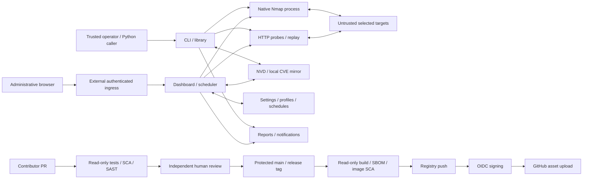

# AutoPWN Suite threat model and attack surface

Assessed 2026-10-15. Runtime scope is v2.6.0; the model also covers proposed
Baseline 2/3 CI and release automation on `security/openssf-baseline-2`.
An independent, fresh-context source review mapped runtime resources; the parent
verified material consumers and reconciled the subsequently separated release
jobs. This is static architecture analysis, not a penetration test or a new
repository security audit. The five validated runtime findings remain attributed
to [the assessment](SECURITY_ASSESSMENT.md), not newly discovered here.

## 1. Overview

AutoPWN Suite is a trusted-operator security scanner. CLI, Python callers and the
dashboard select targets/options, run native Nmap, query online NVD or a local
mirror, optionally probe web services and produce observations/exports.
Dashboard settings, profiles and schedules persist; scan jobs/checkpoints remain
in process memory. There is no multi-tenant identity or object-ownership model.

| Component | Entry point or consumer |
| --- | --- |
| CLI and configuration | `autopwn.py:101`, `autopwn.py:127`, `modules/utils.py:697` |
| Synchronous library | `api.py:98`, `api.py:170` |
| Dashboard, scheduler, browser | `modules/web_ui.py:1452`, `modules/web_ui.py:1505`, `modules/web_ui_static/app.js:980` |
| Native scanning and XML | `modules/nmap_backend.py:139`, `modules/nmap_progress.py:45` |
| Web probes and recorded-evidence replay | `modules/web/http.py:125`, `modules/web/poc_runtime.py:318` |
| Providers and database | `modules/nist_search.py:80`, `modules/vulnerability_db.py:31` |
| Notifications and downloads | `modules/report.py:36`, `modules/getexploits.py:126` |
| Installed/service/container startup | `install.sh:27`, `modules/daemon/daemon_installer.py:298`, `Dockerfile:22`, `docker-compose.yml:6` |
| CI and release | `.github/workflows/security.yml:20`, `.github/workflows/publish-docker.yml:24`, `scripts/release_assets.py:23` |

Ingress authentication is an operator obligation, not a built-in application
feature. GitHub protection and provider credentials are independently enforced
external controls; a diagram does not establish their live configuration.

### Effective resources and startup differences

In the table, `ROOT` means the checkout directory; `CWD` is the invoking process's
working directory. Each listed JSON path is an ordinary unencrypted file.
`AUTOPWN_DATA_DIR` overrides the module directory for dashboard JSON and the
default CVE database only. Use an absolute path: dashboard resolution does not
expand a leading tilde (`modules/web_ui.py:144`,
`modules/vulnerability_db.py:31`).

| Deployment or workflow | Resource or capability | Configuration and precedence | Safe effective value/location | Readers/writers or recipients | Enforcing control / evidence |
| --- | --- | --- | --- | --- | --- |
| Source dashboard | Integration secrets/settings | Data-dir env > module default | `ROOT/modules/web_ui_settings.json` | Process, host-authorized readers/backups, settings API clients | Host ACL/umask; atomic replacement, no encryption; `modules/web_ui.py:148`, `modules/web_ui.py:227`, `modules/web_ui.py:1819` |
| Source dashboard | Profiles | Same data-dir chain | `ROOT/modules/web_ui_profiles.json` | API clients, scheduler, host readers | Validation/locks and host permissions; `modules/web_ui.py:303` |
| Source dashboard | Schedules | Same data-dir chain | `ROOT/modules/web_ui_schedules.json` | API clients, scheduler, host readers | Validation/locked launch; `modules/web_ui.py:331`, `modules/web_ui.py:1468` |
| Installed wrapper dashboard | Settings | Env > installed module default | `/opt/autopwn-suite/modules/web_ui_settings.json` | Invoking account, host readers, API clients | Wrapper preserves identity/CWD; `install.sh:6`, `install.sh:39`, `modules/web_ui.py:148` |
| Installed wrapper dashboard | Profiles | Same installed data-dir chain | `/opt/autopwn-suite/modules/web_ui_profiles.json` | Process/API/scheduler | Host permissions/profile validation; `install.sh:6`, `modules/web_ui.py:303` |
| Installed wrapper dashboard | Schedules | Same installed data-dir chain | `/opt/autopwn-suite/modules/web_ui_schedules.json` | Process/API/scheduler | Host permissions/scheduler validation; `install.sh:6`, `modules/web_ui.py:331` |
| Plain Docker | Settings | No data-dir env in image | `/app/modules/web_ui_settings.json` | Container process, API, host-authorized storage readers | Runtime filesystem controls; `Dockerfile:3`, `Dockerfile:17`, `modules/web_ui.py:148` |
| Plain Docker | Profiles | Module default | `/app/modules/web_ui_profiles.json` | Process/API/scheduler | Runtime permissions; `Dockerfile:3`, `modules/web_ui.py:303` |
| Plain Docker | Schedules | Module default | `/app/modules/web_ui_schedules.json` | Process/API/scheduler | Runtime permissions; `Dockerfile:3`, `modules/web_ui.py:331` |
| Supplied Compose | Settings | Explicit data-dir env + named volume | `/data/web_ui_settings.json` | Process/API, volume readers/backups | Volume/host permissions, no encryption; `docker-compose.yml:6`, `modules/web_ui.py:148` |
| Supplied Compose | Profiles | Same Compose mapping | `/data/web_ui_profiles.json` | Process/API/scheduler/volume readers | Profile validation; `docker-compose.yml:9`, `modules/web_ui.py:303` |
| Supplied Compose | Schedules | Same Compose mapping | `/data/web_ui_schedules.json` | Process/API/scheduler/volume readers | Schedule validation; `docker-compose.yml:9`, `modules/web_ui.py:331` |
| Source CLI/library/dashboard | CVE mirror | Explicit database > data-dir env > module default | `ROOT/modules/vulnerabilities.sqlite3` | Read-only scan snapshots, explicit updater, dashboard download clients | Read-only transaction/staged replacement; `modules/vulnerability_db.py:31`, `modules/vulnerability_db.py:75`, `modules/web_ui.py:1754` |
| Installed wrapper/daemon | CVE mirror | Same explicit/env/default chain | `/opt/autopwn-suite/modules/vulnerabilities.sqlite3` | Invoking account or root daemon, updater | Host permissions + DB controls; `install.sh:6`, `modules/daemon/daemon_installer.py:298`, `modules/vulnerability_db.py:31` |
| Plain Docker | CVE mirror | Explicit path > runtime env > module default | `/app/modules/vulnerabilities.sqlite3` | Container scanner/updater/API download | Runtime permissions + DB controls; `Dockerfile:3`, `modules/vulnerability_db.py:31` |
| Supplied Compose | CVE mirror | Explicit path > `AUTOPWN_DATA_DIR=/data` | `/data/vulnerabilities.sqlite3` | Scanner/updater/API, volume readers | Volume permissions + DB controls; `docker-compose.yml:6`, `modules/vulnerability_db.py:31` |
| Explicit DB updates | Lock/staging/feed files | Derived from resolved DB parent | `<database>.update-lock`, sibling `.nvd-*.sqlite3`, temporary feed files | Updater and authorized file readers | Exclusive update transaction, hash/size validation, fsync/replace/cleanup; `modules/vulnerability_db.py:214`, `modules/vulnerability_db.py:253`, `modules/vulnerability_db.py:282` |
| Source/native CLI | NVD key | INI > CLI key > CWD `api.txt`; offline skips | Credential reference only, optional `CWD/api.txt` | Scanner/NVD API header | Host permissions + provider HTTPS; `modules/utils.py:428`, `modules/utils.py:717`, `modules/nist_search.py:120` |
| Library | Key and export | Explicit caller arguments | In-memory key; default `CWD/autopwn.json` | Calling app, NVD, file readers | Caller authority; no dashboard settings load; `api.py:98`, `api.py:170` |
| Dashboard | NVD key | Per-job key > persisted NVD key | Secret reference in deployment-specific settings | NVD; administrative settings API | Ingress/ACL; job serialization removes key; `modules/web_ui.py:541`, `modules/web_ui.py:939`, `modules/web_ui.py:1819` |
| CLI through source/wrapper | Reports | Explicit output > output folder > CWD default | `CWD/outputs/YYYY-MM-DD_<target>.<format>` | Operator/file readers | Account permissions, filename sanitization; `modules/utils.py:984`, `install.sh:39` |
| Docker CLI | Reports | Same CWD rules | `/app/outputs/...` by default, outside Compose data volume | Operator/container-storage readers | Runtime permissions; `Dockerfile:3`, `modules/utils.py:984` |
| Root daemon | INI/report/log | Generated config; unit sets account and CWD | `/opt/autopwn-suite/autopwn-daemon.conf`, `/opt/autopwn-suite/outputs/...`, `/var/log/autopwn-daemon.log` | Root process, host readers, configured receivers | Unit explicitly runs root; log creation mode 0664; `modules/daemon/daemon_installer.py:279`, `modules/daemon/daemon_installer.py:298`, `modules/daemon/daemon_installer.py:305` |
| Explicit exploit download | Reference bytes | CWD + sanitized product/CVE/filename | `CWD/exploits/<product>/<CVE>/<filename>`; daemon CWD `/opt/autopwn-suite`, Docker CWD `/app` | Operator/file readers | Numeric provider IDs/path sanitization; no execution step; `modules/getexploits.py:57`, `modules/getexploits.py:126` |
| CLI notifications | Temporary report | OS temp selection + random directory | `<OS-temp>/autopwn-report-*/report.html` or `report.log` | Process, SMTP/webhook receiver | TemporaryDirectory cleanup, OS permissions; `modules/report.py:47`, `modules/report.py:105` |
| Dashboard | Jobs/evidence/logs/exports | Process registries and attachment responses | Memory; 5000 log entries, 100 completed scans; no persistent job recovery | Administrative API/SSE clients | Locks, bounded histories, selected redaction, external ingress; `modules/web_ui.py:602`, `modules/web_ui.py:632`, `modules/web_ui.py:1543`, `modules/web_ui.py:1794` |
| Native scanning | Nmap executable and temporary output | Adapter path or PATH; process identity | argv process; 1 MiB spool thresholds then OS temp | Nmap, selected targets, XML parser | Target/option checks, shell=False, process cleanup; `modules/nmap_backend.py:142`, `modules/nmap_progress.py:45`, `modules/nmap_progress.py:69`, `modules/nmap_progress.py:118` |
| Source CLI/dashboard | Listener | INI WEBUI > CLI flags > environment defaults | `0.0.0.0:8080` absent overrides | Clients admitted by host ingress | Socket bind + external access control; `modules/utils.py:314`, `modules/utils.py:743`, `modules/utils.py:778`, `modules/web_ui.py:2075` |
| Direct library server call | Listener | Function arguments/defaults, no independent env lookup | `0.0.0.0:8080` absent arguments | Caller-deployment clients | Caller bind/ingress; `modules/web_ui.py:2041` |
| Supplied Compose | Listener | Compose env; later CLI/INI still possible | `0.0.0.0:8080` with host networking | Host-network clients allowed by firewall | Localhost wording is an access URL, not restriction; `docker-compose.yml:7`, `docker-compose.yml:12`, `modules/web_ui.py:2071` |
| Web checks | Target requests | Operator target, origin guard, bounded options | Default budget 10000, inactivity timeout 10s, 1024 KiB prefix | Target; ambient credentials possible in assessed core paths | Independent ProbeClient anonymous-auth vs core path controls; `modules/web/http.py:21`, `modules/web/http.py:60`, `modules/web/http.py:125`, `modules/web/options.py:19` |
| Evidence replay | Restricted request capability | Stored finding -> generated validated plan; reject submitted plans/body | Same origin, GET/OPTIONS/TRACE, at most 12 requests, four concurrent verifications | Recorded target/operator | trust_env=False, no redirects, cookie clearing, prefix cap; `modules/web_ui.py:1660`, `modules/web/poc_runtime.py:28`, `modules/web/poc_runtime.py:318` |
| Notifications | SMTP/webhook credentials/reports | Explicit CLI or enabled dashboard settings; offline gates | Configured recipients, secret references only | Selected receiver | Timeouts and enable/offline gates; SMTP validation limitation remains; `modules/report.py:75`, `modules/report.py:100`, `modules/web_ui.py:695`, `modules/web_ui.py:739` |
| Contributor CI | Candidate source execution | PR/push -> hosted tests/scanners | Read-only GitHub credentials, no publishing secrets | Runner/package providers | Explicit permissions, no persisted checkout credential; `.github/workflows/poetry-tests.yml:14`, `.github/workflows/security.yml:22` |
| Release validation | Versioned source archives/VEX | Valid tag, versions, origin/main ancestry | Runner-temp assets from exact tagged commit | Read-only validation job | Empty staging/existing-assets refusal; `scripts/release_assets.py:23`, `.github/workflows/publish-docker.yml:24` |
| Release build | Image archives and per-architecture SBOMs | Validated commit -> isolated amd64/arm64 builds -> scans | Runner-temp image/SBOM/reports | Read-only build runner; no registry/OIDC secrets | Source policy and actual image SCA precede push; `.github/workflows/publish-docker.yml:71` |
| Registry push | Distribution capability | Successful build/scan artifacts only | `docker.io/gamehunterkaan/autopwn-suite:<version>` | Docker Hub | Docker publishing secret only; no GitHub token permissions; `.github/workflows/publish-docker.yml:131` |
| OIDC signing | Image digest and manifest authenticity | Push digest + archived source/SBOM/VEX -> verified signatures | Exact SHA-256 image digest and asset hashes | Registry/Sigstore, downstream verifiers | contents:read, id-token:write, registry signing access; `.github/workflows/publish-docker.yml:166` |
| GitHub publication | Release assets/notes | Successfully signed artifact handoff | Version-associated assets, no overwrite flag | GitHub release API/users | contents:write only; no checkout, OIDC or registry credentials; `.github/workflows/publish-docker.yml:211` |

Importing the CLI imports web_ui and creates its effective data directory before
argument parsing; dashboard startup loads the JSON files later
(`autopwn.py:32`, `modules/web_ui.py:147`, `modules/web_ui.py:2058`).
The normal Python API does not start the dashboard. The wrapper does not chdir,
whereas the root daemon does. Actual Windows ACLs, volume host backing paths,
OS temporary directories, selected executable and deployed firewall/proxy
configuration are unverified external resources; this model does not assume
their protection.

## 2. Threat model, trust boundaries and assumptions

Protect the scanner account's native/filesystem/network authority, observations,
operator browser, credential confidentiality, settings/schedule integrity,
database integrity and release identity. An untrusted target controls responses,
HTML, redirects, certificates and timing; it does not start with operator or
release authority. A reachable dashboard client currently receives administrative
API power without an application login. A profile writer can also affect later
browser rendering. A network intermediary needs an applicable transport and
credential/report flow. A contributor can propose changes and exercise the test
runner, without entitlement to publishing credentials.

Trusted CLI/library/configuration users already possess their account authority.
Selecting a target/export path or powerful Nmap/NSE option is not by itself a new
attacker capability. The generated service runs root and the image declares no
USER; do not infer isolation from argv/shell=False or a container label.
Nmap target/owned-output validation and subprocess cleanup are independent from
the dashboard administration boundary.

External provider data enters NVD parsing, local DB updates and exploit-reference
storage. Database readers use read-only snapshots and parameterized operations;
updates validate/stage/replace. Advertised feed hashes and feed bytes share the
same provider HTTPS boundary, not an independent signature
(`modules/vulnerability_db.py:214`). Downloads save bytes without executing them.
Replay validates a generated recorded-evidence plan; it does not accept arbitrary
client-supplied code/plans. Those controls do not extend automatically to core web
requests, browser rendering, SMTP or host storage.

Security objectives are: preserve data/code separation; prevent unsolicited
credential disclosure and target-to-host/browser authority gains; restrict
dashboard ingress to operators; protect persistent configuration/backups; enforce
origin/method/count/byte limits; expose partial results; and publish only selected
reviewed bytes bound to expected signer identity. Strict offline mode suppresses
online integrations and web checks but selected Nmap traffic remains expected.
Native hostname/NSE behavior is still an operator obligation
(`autopwn.py:40`, `modules/web_ui.py:265`, `docs/ARCHITECTURE.md:76`).

Count/byte/inactivity limits are not total wall-clock deadlines. Atomic JSON
replacement is not encryption or user isolation. A saved profile is not a saved
job checkpoint. CORS and displayed localhost URLs are not access control.
Tag ancestry is not proof of human review. A configured signing/SBOM workflow is
not evidence that historical artifacts were signed or inventoried. No private
credential files or deployed targets were accessed for this model.

## 3. Attack surface, mitigations and attacker stories

The first five rows refer to the independently validated v2.6.0 assessment;
remaining rows are threat scenarios and control analysis, not new findings.

| Priority | Scenario and capability gain | Prerequisites | Impact | Existing controls | Mitigation | Evidence |
| --- | --- | --- | --- | --- | --- | --- |
| Medium / open | Reachable client gains dashboard administrative operations | Untrusted client reaches listener | Read/change integrations/jobs, invoke native scanner authority | External ingress only; no login | Loopback/authenticated ingress/firewall; application auth follow-up | `modules/web_ui.py:1505`, `modules/web_ui.py:1590`, `modules/web_ui.py:1819`; advisory AUTOPWN-SA-2026-001 |
| Medium / open | Profile description becomes operator-origin script | Profile writer + later operator view | Browser-origin authority | Profile names escaped; description path remains open | Render description as text; restrict writers | `modules/web_ui.py:1910`, `modules/web_ui_static/app.js:988`; AUTOPWN-SA-2026-002 |
| Medium / open | SMTP intermediary captures login/report | Email enabled + active intermediary/forged endpoint | Credential/report disclosure | TLS invocation/timeouts, no verified context | Disable email or use protected transport pending context fix | `modules/report.py:77`, `modules/web_ui.py:739`; AUTOPWN-SA-2026-003 |
| Medium / open | Core web probe sends ambient credentials | Applicable matching/default credential entry | Credential disclosure to selected target/intermediary | Additional probes/replay suppress credentials; core paths differ | Dedicated account without ambient secrets; extend suppression | `modules/web/http.py:152`, `modules/web/dirbust.py:61`; AUTOPWN-SA-2026-004 |
| Medium / open | Trickle response retains workers despite Stop | Selected hostile target streams below inactivity timeout | Worker/verification-slot exhaustion | Byte/count limits; Nmap has distinct process deadline | External process deadline pending transport fix | `modules/web/http.py:21`, `modules/web/poc_runtime.py:329`; AUTOPWN-SA-2026-005 |
| High-impact hypothesis | Malicious dependency/action executes during privileged publication | Compromised dependency or approved automation; actual job authority needed | Distribution compromise | Read-only PR jobs, pinned tools/actions, secret-free builds, separate push/sign/upload | Review provenance, require all gates and non-author human; inspect artifacts | `.github/workflows/security.yml:20`, `.github/workflows/publish-docker.yml:71`, `.github/workflows/human-review.yml:23` |
| High-impact hypothesis | Forged/replaced artifact trusted by consumer | Distribution channel compromise; verifier omits expected identity/digest | Execute substituted release | Signed hashes/digest and exact issuer/workflow verification design | Follow release verification; never trust mutable tags alone | `scripts/release_assets.py:105`, `docs/RELEASING.md:1` |
| Medium hypothesis | Local/backup reader obtains plaintext settings/INI/evidence | Host/volume/file access beyond intended scanner account | Secret/evidence exposure, future schedule changes | Host ACLs/ingress; atomic replacement only | Owner-only storage, encrypted backups, rotation, dedicated account | `modules/web_ui.py:148`, `modules/daemon/daemon_installer.py:300`, `docs/SECRETS.md:1` |
| Conditional parser/provider hypothesis | Malformed target/feed data crosses interpreter/storage boundary | Selected target/provider response | Parser denial of service or data corruption; execution requires further evidence | argv, XML parsing, origin checks, parameterized DB, staged updates, sanitized paths | Preserve limits, review parsers/schema changes and regressions | `modules/nmap_backend.py:99`, `modules/vulnerability_db.py:253`, `modules/getexploits.py:126` |
| Controlled boundary | Arbitrary replay/write or download execution | Client tries to submit a plan/foreign origin; operator separately executes attachment | No new capability established through reviewed replay/download interface | Empty-body requirement, generated plan validation, origin/header/method limits; downloads not executed | Preserve these independent controls and tests | `modules/web_ui.py:1638`, `modules/web_ui.py:1660`, `modules/web/poc_runtime.py:28` |

Review new features and breaking changes against this table before release.
Update concrete paths, actors and invariants when configuration, authentication,
HTTP transport, persistence, native execution or release privileges change.
Track actual findings in [advisories](SECURITY_ADVISORIES.md) with affected/fixed
versions. Do not turn an unresolved scenario into a VEX not-affected claim.

## 4. Severity calibration (Critical, High, Medium, Low)

- **Critical:** credible unauthenticated compromise of widely deployed scanner
  hosts or trusted release distribution, with a demonstrated authority gain and
  few prerequisites. A theoretical dangerous function alone does not qualify.
- **High:** likely theft of privileged credentials or host execution across a real
  untrusted boundary, with evidence establishing exposure and capability gain.
  Compromised operator credentials are an initial compromise, not proof that an
  ordinary operator feature is vulnerable.
- **Medium:** meaningful confidentiality/integrity/availability impact requiring
  dashboard exposure, saved-profile interaction, applicable ambient credentials,
  active interception or a selected hostile streaming target. These conditions
  calibrate the existing five findings; impact alone does not establish likelihood.
- **Low:** limited information leakage or recoverable disruption without a
  substantial new capability; remaining trust/configuration prerequisites must
  still be stated. Pure self-effects within already authorized operator power,
  ordinary configuration flexibility and unsupported exposure assumptions are
  not findings.

Confidence describes evidence quality, separately from severity. Live exposure,
actual credentials, deployed ACLs and completed signed publication remain
unverified. The snapshot below hashes non-Markdown source/configuration inputs
in sorted repository-path order as path-NUL-bytes-NUL, excluding ignored files.
It identifies the inspected architecture inputs, not a signed software release.

Repository: target_sha256_f4729301817a49c0c92d2ef33ffd0bd514e1296e7084a6d623842b3beb1924f8
Version: snapshot:7e201add497cf1534a43e20e6f10d7ff92e9d9490f6c88d3aa17b719143699fc
